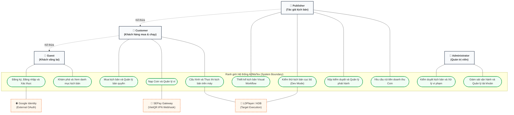
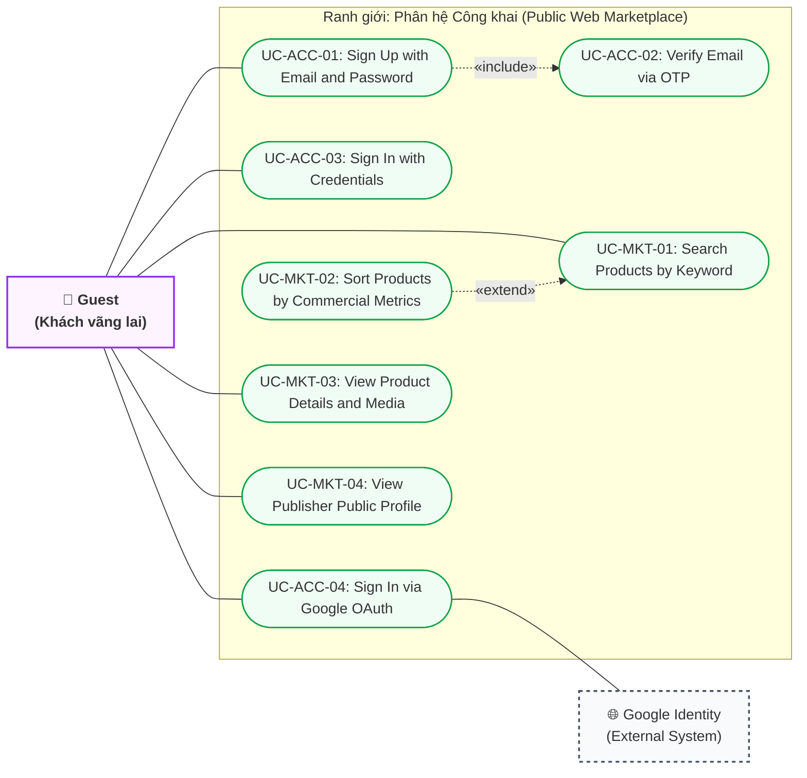
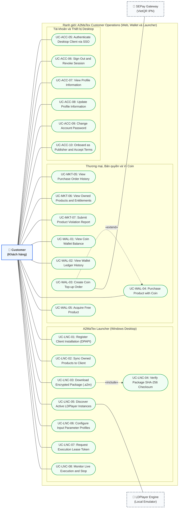
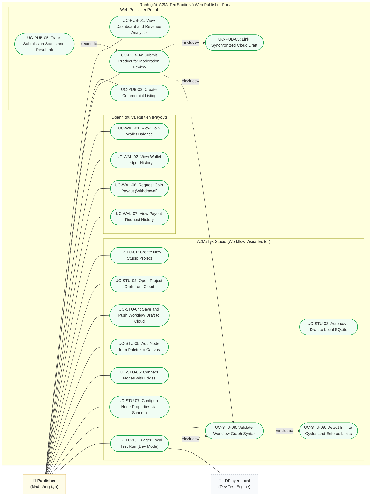
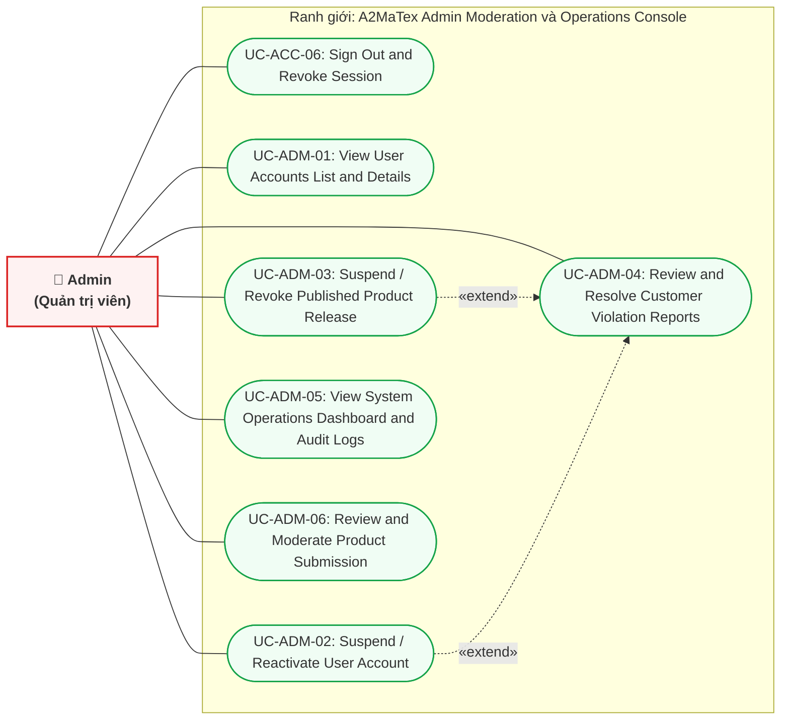

# A2MATEX — BẢNG ĐẶC TẢ PHÂN RÃ USE CASE CHI TIẾT & PHÂN CÔNG NHIỆM VỤ (BẢN CHUẨN HÓA TOÀN DIỆN)
**Dự án:** A2MaTex (Android Automation Marketplace & Ecosystem)  
**Đồ án tốt nghiệp:** SEP490 - FA26 - G52 (FPT University)  
**Lead Documentation & Lead BA:** Khuyentv  
**Quy chuẩn áp dụng:** Chuẩn hóa UML 2.5 (Loại bỏ hoàn toàn Background Worker/Daemon khỏi Actor Use Cases, cập nhật chi tiết theo phản hồi kiến trúc thực tế)

---

## I. NGUYÊN TẮC CẢI TIẾN & PHÂN ĐỊNH RANH GIỚI

1. **Loại bỏ hoàn toàn Phần 4 (Backend Worker) & Phần 6 (Runtime Go Daemon):**  
   - Các tác vụ như quét mã tự động, biên dịch gói `.a2m`, giải mã RAM, chạy Goroutines ADB, ghi SQLite cục bộ... là **hành vi kỹ thuật chạy ngầm (Internal System Processing)**. Chúng không phải là Actor Use Case, do đó được đưa vào phần Kiến trúc kỹ thuật (Technical Architecture & Sequence Diagrams) thay vì danh mục Use Case người dùng.
2. **Khuyentv đảm nhận vị trí Lead Documentation (~57% khối lượng Use Cases):**  
   - Trực tiếp viết 30 Use Cases bao quát toàn bộ: Định danh (Identity), Khám phá sản phẩm (Marketplace), Ví Coin & Giao dịch thanh toán (Commerce & Wallet), và Bàn điều khiển quản trị tối cao của Admin (Moderation & Operations Console).
3. **Cập nhật chính xác các điều chỉnh nghiệp vụ từ đội ngũ:**
   - `UC-ACC-07`: Tách riêng thành **Xem thông tin cá nhân** và **Cập nhật thông tin cá nhân**.
   - `UC-ACC-09` & `10`: Gộp thành **Đăng ký Publisher & Ký cam kết Điều khoản**.
   - `UC-MKT-01` & `UC-MKT-03`: Bỏ (tích hợp tìm kiếm trực tiếp trên thanh công cụ).
   - `UC-MKT-07`: Tách bạch giữa **Lịch sử đơn hàng đã mua (Purchase History)** và **Sản phẩm đang sở hữu / Bản quyền còn hạn (Active Entitlements)**.
   - `UC-WAL-09`: Bỏ việc Admin duyệt Payout thủ công (hệ thống xử lý Payout tự động qua API).
   - `UC-PUB-03` & `UC-PUB-04`: Bỏ (gộp upload media và định giá Coin vào chung form tạo Listing).
   - `UC-STU-02`: Đổi thành **Mở bản thảo Draft đã lưu trên Cloud** (bỏ `.a2mp` vì `.a2m` là gói sau khi build).
   - `UC-STU-03`: **Auto-save (Debounce Save) bản thảo vào SQLite cục bộ**.
   - Bổ sung `UC-STU-04`: **Publisher chủ động bấm Save Draft đẩy lên Cloud Backend**.

---

## II. MA TRẬN PHÂN CÔNG TỔNG HỢP THEO THÀNH VIÊN

| Thành viên | Vai trò phụ trách | Số lượng UC | Trọng số Docs | Phạm vi nghiệp vụ phụ trách |
| :--- | :--- | :---: | :---: | :--- |
| **Khuyentv** | **Lead BA & Lead Docs** | **30 UC** | **~57%** | **Toàn bộ Identity, Profile, Marketplace Web, Ví Coin & Giao dịch, Admin Console** |
| **Dev Marketplace** | Frontend Web Developer | **5 UC** | ~9% | **Web Publisher Portal: Listing Commercial, Link Cloud Draft, Submit & Resubmit** |
| **Dev IDE** | Studio Desktop Developer | **10 UC** | ~19% | **A2MaTex Studio: Cloud Draft Open/Save, Debounce SQLite, Canvas Nodes/Edges, Dev Test** |
| **Launcher / Fullstack Dev** | Launcher Client Developer | **8 UC** | ~15% | **A2MaTex Launcher: Installation DPAPI, Tải & Check SHA-256, Map LDPlayer, Xin Lease, Monitor** |
| **Backend & Runtime Devs** | Backend & Runtime Engineers | *Docs Kỹ thuật* | — | **Tập trung viết Data Model, API Specs, Goroutines Engine & Sequence Diagrams** |
| **TỔNG CỘNG** | **Cả nhóm G52** | **53 UC** | **100%** | **Đầy đủ, cô đọng, chuẩn mực 100% UML đồ án tốt nghiệp** |

---

## III. MA TRẬN TRA CỨU THEO ACTOR

| Actor | Phạm vi phân hệ | Danh sách mã Use Case tương ứng |
| :--- | :--- | :--- |
| **Guest** | Web Marketplace | `UC-ACC-01`, `UC-ACC-02`, `UC-ACC-03`, `UC-ACC-04`, `UC-MKT-01` $\rightarrow$ `UC-MKT-04` |
| **Customer** | Web Marketplace, Ví Coin, Launcher | `UC-ACC-05`, `UC-ACC-06`, `UC-ACC-07`, `UC-ACC-08`, `UC-ACC-09` `UC-WAL-01` $\rightarrow$ `UC-WAL-05` `UC-MKT-05`, `UC-MKT-06`, `UC-MKT-07` `UC-LNC-01` $\rightarrow$ `UC-LNC-08` |
| **Publisher** | Studio Desktop, Web Portal, Ví Coin | `UC-ACC-05`, `UC-ACC-06`, `UC-ACC-07`, `UC-ACC-08`, `UC-ACC-10` `UC-WAL-01`, `UC-WAL-02`, `UC-WAL-06`, `UC-WAL-07` `UC-PUB-01` $\rightarrow$ `UC-PUB-05` `UC-STU-01` $\rightarrow$ `UC-STU-10` |
| **Admin** | Web Admin Console | `UC-ADM-01` $\rightarrow$ `UC-ADM-06` |

---

## IV. SƠ ĐỒ USE CASE CHUẨN HÓA (UML 2.5 USE CASE DIAGRAMS)

> **Quy chuẩn phương pháp luận áp dụng (Tuân thủ nghiêm ngặt 5 nguyên tắc chuẩn BA & UML 2.5):**
> 1. **Goal-oriented Use Cases (Hướng mục tiêu nghiệp vụ):** Từng Use Case đại diện cho một mục tiêu nghiệp vụ trọn vẹn mang lại giá trị đo lường được cho Actor; tuyệt đối loại bỏ các thao tác bấm nút UI vụn vặt và hành vi ngầm của hệ thống.
> 2. **No Time Sequence (Không vẽ theo thứ tự thời gian):** Sơ đồ Use Case không phải Activity Diagram, không dùng mũi tên nối bước 1 sang bước 2. Mối quan hệ giữa các Use Case chỉ bao gồm `<<include>>`, `<<extend>>` và `Generalization`.
> 3. **Chuẩn hóa quan hệ `<<include>>` và `<<extend>>`:** 
>    - `<<include>>`: Trỏ từ Base Use Case $\longrightarrow$ Included Use Case (phần việc bắt buộc phải chạy và có tính tái sử dụng). Loại bỏ triệt để việc nối include auto-save hay đăng nhập bừa bãi.
>    - `<<extend>>`: Trỏ từ Extension Use Case $\longrightarrow$ Base Use Case (chỉ kích hoạt có điều kiện tại *Extension Point*, ví dụ: nạp thêm coin khi số dư không đủ).
> 4. **Phân cấp Actor & Ranh giới Actor ngoài (Actor Generalization & External Systems):** `Customer` kế thừa từ `Guest`, `Publisher` kế thừa từ `Customer`. Các hệ thống bên thứ 3 (`Google Identity`, `Payment Gateway SEPay`, `LDPlayer Console`) được định danh là Secondary/Supporting Actors và đặt ngoài ranh giới hệ thống.
> 5. **System Boundary rõ ràng:** Khung ranh giới phân định rõ phạm vi trách nhiệm của hệ thống A2MaTex với môi trường bên ngoài.

---

### 1. Sơ đồ Use Case Tổng thể Hệ sinh thái A2MaTex (High-Level System Overview Diagram)

Sơ đồ này thể hiện ranh giới hệ thống toàn cảnh, sự phân cấp kế thừa giữa các Actor và các gói năng lực cốt lõi:

---

### 2. Sơ đồ Use Case Chi tiết — Phân hệ Công khai & Khách vãng lai (Guest)

---

### 3. Sơ đồ Use Case Chi tiết — Phân hệ Khách hàng (Customer Scope)

---

### 4. Sơ đồ Use Case Chi tiết — Phân hệ Tác giả kịch bản (Publisher Scope)

---

### 5. Sơ đồ Use Case Chi tiết — Phân hệ Quản trị viên (Admin Console)

---

## V. BẢNG PHÂN RÃ CHI TIẾT TỪNG USE CASE (53 USE CASES)

---

### PHẦN 1: KHUYENTV (LEAD BA & LEAD DOCS) — 30 USE CASES

#### A. Phân hệ Định danh & Quản lý người dùng (Identity & Access) — 10 UC
1. **`UC-ACC-01`: Sign Up with Email & Password**  
   - *Primary Actor:* Guest | *Supporting:* Web, Backend  
   - *Mô tả:* Người dùng nhập email, mật khẩu và xác nhận mật khẩu để tạo tài khoản mới.
2. **`UC-ACC-02`: Verify Email via OTP**  
   - *Primary Actor:* Guest | *Supporting:* Web, Backend  
   - *Mô tả:* Nhập mã OTP 6 số gửi qua email để kích hoạt tài khoản chính thức.
3. **`UC-ACC-03`: Sign In with Credentials**  
   - *Primary Actor:* Guest | *Supporting:* Web, Backend  
   - *Mô tả:* Xác thực email/password, trả về cặp JWT Access Token và Refresh Token.
4. **`UC-ACC-04`: Sign In via Google OAuth**  
   - *Primary Actor:* Guest | *Supporting:* Web, Backend, Google Identity Provider  
   - *Mô tả:* Đăng nhập nhanh bằng tài khoản Google, tự động liên kết hoặc tạo tài khoản mới.
5. **`UC-ACC-05`: Authenticate Desktop Client via Custom Protocol (SSO)**  
   - *Primary Actor:* Customer, Publisher | *Supporting:* Studio, Launcher, Web, Backend  
   - *Mô tả:* Đăng nhập trên trình duyệt Web và truyền token an toàn về Desktop Client qua giao thức URI tùy biến (`a2matex://auth/callback`).
6. **`UC-ACC-06`: Sign Out & Revoke Session**  
   - *Primary Actor:* Customer, Publisher, Admin | *Supporting:* Web, Desktop, Backend  
   - *Mô tả:* Đăng xuất, hủy Refresh Token trong database và xóa session an toàn trên client.
7. **`UC-ACC-07`: View Profile Information** *(Đã tách riêng)*  
   - *Primary Actor:* Customer, Publisher | *Supporting:* Web, Backend  
   - *Mô tả:* Xem thông tin cá nhân chi tiết, email, ngày tham gia, vai trò và trạng thái xác thực.
8. **`UC-ACC-08`: Update Profile Information** *(Đã tách riêng)*  
   - *Primary Actor:* Customer, Publisher | *Supporting:* Web, Backend  
   - *Mô tả:* Cập nhật họ tên, số điện thoại, tải ảnh đại diện (avatar) mới lên hệ thống.
9. **`UC-ACC-09`: Change Account Password**  
   - *Primary Actor:* Customer, Publisher | *Supporting:* Web, Backend  
   - *Mô tả:* Nhập mật khẩu hiện tại và đổi sang mật khẩu mới với tiêu chuẩn an toàn.
10. **`UC-ACC-10`: Onboard as Publisher & Accept Terms of Service** *(Đã gộp acc-09 & 10)*  
    - *Primary Actor:* Customer | *Supporting:* Web, Backend  
    - *Mô tả:* Điền thông tin thương hiệu Publisher, số tài khoản ngân hàng nhận tiền và ký chấp thuận Điều khoản xuất bản, chính sách bản quyền và chống mã độc.

#### B. Phân hệ Khám phá & Quản lý sở hữu (Marketplace Catalog) — 7 UC
*(Đã bỏ UC-MKT-01 Browse chung và UC-MKT-03 Filter)*
11. **`UC-MKT-01`: Search Products by Keyword**  
    - *Primary Actor:* Guest, Customer | *Supporting:* Web, Backend  
    - *Mô tả:* Tìm kiếm kịch bản theo tên sản phẩm, tên Publisher, từ khóa nghiệp vụ (hỗ trợ full-text search).
12. **`UC-MKT-02`: Sort Products by Commercial Metrics**  
    - *Primary Actor:* Guest, Customer | *Supporting:* Web, Backend  
    - *Mô tả:* Sắp xếp danh sách kịch bản theo Giá Coin (tăng/giảm), Lượt tải nhiều nhất, Đánh giá uy tín nhất.
13. **`UC-MKT-03`: View Product Details & Media**  
    - *Primary Actor:* Guest, Customer | *Supporting:* Web, Backend  
    - *Mô tả:* Xem mô tả chi tiết, hình ảnh chụp màn hình, video demo, giá bán Coin và yêu cầu phiên bản LDPlayer.
14. **`UC-MKT-04`: View Publisher Public Profile**  
    - *Primary Actor:* Guest, Customer | *Supporting:* Web, Backend  
    - *Mô tả:* Xem trang cá nhân của Publisher, danh mục các sản phẩm đã phát hành và điểm đánh giá từ cộng đồng.
15. **`UC-MKT-05`: View Purchase Order History** *(Tách mới: Xem lịch sử đơn hàng đã mua)*  
    - *Primary Actor:* Customer | *Supporting:* Web, Backend  
    - *Mô tả:* Tra cứu danh sách các hóa đơn/giao dịch đã mua, ngày mua, số Coin đã thanh toán và mã đơn hàng.
16. **`UC-MKT-06`: View Owned Products & Active Entitlements** *(Tách mới: Xem sản phẩm đang sở hữu)*  
    - *Primary Actor:* Customer | *Supporting:* Web, Backend  
    - *Mô tả:* Quản lý các kịch bản đang sở hữu quyền sử dụng (`Entitlement`), thời hạn bản quyền còn lại, hạn mức số máy Windows và số LDPlayer được phép chạy đồng thời.
17. **`UC-MKT-07`: Submit Product Violation Report**  
    - *Primary Actor:* Customer | *Supporting:* Web, Backend  
    - *Mô tả:* Gửi đơn khiếu nại kịch bản lỗi, lừa đảo hoặc vi phạm chính sách kèm bằng chứng ảnh/video.

#### C. Phân hệ Ví Coin & Giao dịch tài chính (Commerce & Wallet) — 7 UC
*(Đã bỏ UC-WAL-09 Admin duyệt Payout vì hệ thống thực hiện rút tiền tự động qua API)*
18. **`UC-WAL-01`: View Coin Wallet Balance**  
    - *Primary Actor:* Customer, Publisher | *Supporting:* Web, Backend  
    - *Mô tả:* Xem số dư Coin khả dụng, số dư đang bị đóng băng (đang trong tiến trình rút tiền) theo thời gian thực.
19. **`UC-WAL-02`: View Wallet Ledger History**  
    - *Primary Actor:* Customer, Publisher | *Supporting:* Web, Backend  
    - *Mô tả:* Xem sao kê chi tiết lịch sử biến động số dư: Nạp tiền (+), Mua tool (-), Nhận doanh thu bán (+), Rút tiền (-).
20. **`UC-WAL-03`: Create Coin Top-up Order**  
    - *Primary Actor:* Customer | *Supporting:* Web, Backend, SePay/VietQR  
    - *Mô tả:* Nhập số tiền VND muốn nạp $\rightarrow$ hệ thống sinh mã đơn hàng kèm mã VietQR động chứa nội dung chuyển khoản độc nhất.
21. **`UC-WAL-04`: Purchase Product with Coin (Atomic Transaction)**  
    - *Primary Actor:* Customer | *Supporting:* Web, Backend  
    - *Mô tả:* Giao dịch nguyên tử: trừ Coin Customer, tính % chia cho Publisher, giữ phí sàn và cấp ngay `Entitlement`.
22. **`UC-WAL-05`: Acquire Free Product**  
    - *Primary Actor:* Customer | *Supporting:* Web, Backend  
    - *Mô tả:* Khách hàng nhận quyền sử dụng sản phẩm miễn phí (Free) và nhận ngay `Entitlement` không qua bước trừ ví.
23. **`UC-WAL-06`: Request Coin Payout (Withdrawal)**  
    - *Primary Actor:* Publisher | *Supporting:* Web, Backend  
    - *Mô tả:* Publisher nhập số Coin muốn rút về STK ngân hàng đã đăng ký; hệ thống đóng băng số Coin tương ứng và kích hoạt tiến trình Payout tự động.
24. **`UC-WAL-07`: View Payout Request History**  
    - *Primary Actor:* Publisher | *Supporting:* Web, Backend  
    - *Mô tả:* Xem danh sách các yêu cầu rút tiền đã tạo và trạng thái xử lý tự động (`PROCESSING`, `COMPLETED`, `FAILED`).

#### D. Phân hệ Quản trị & Điều hành hệ thống (Admin Console) — 6 UC
25. **`UC-ADM-01`: View User Accounts List & Details**  
    - *Primary Actor:* Admin | *Supporting:* Web Admin, Backend  
    - *Mô tả:* Tra cứu danh sách người dùng, lọc theo role (Customer/Publisher), xem lịch sử giao dịch và bản cài đặt máy.
26. **`UC-ADM-02`: Suspend / Reactivate User Account**  
    - *Primary Actor:* Admin | *Supporting:* Web Admin, Backend  
    - *Mô tả:* Khóa tạm thời hoặc mở lại quyền truy cập của người dùng vi phạm quy định cộng đồng.
27. **`UC-ADM-03`: Suspend / Revoke Published Product Release**  
    - *Primary Actor:* Admin | *Supporting:* Web Admin, Backend  
    - *Mô tả:* Tạm ẩn khỏi sàn hoặc thu hồi khẩn cấp một bản phát hành kỹ thuật phát hiện chứa lỗi nghiêm trọng.
28. **`UC-ADM-04`: Review & Resolve Customer Violation Reports**  
    - *Primary Actor:* Admin | *Supporting:* Web Admin, Backend  
    - *Mô tả:* Tiếp nhận đơn tố cáo từ Customer, đối soát log thực thi và đưa ra kết luận xử lý (bác bỏ hoặc cảnh cáo/khóa tool).
29. **`UC-ADM-05`: View System Operations Dashboard & Audit Logs**  
    - *Primary Actor:* Admin | *Supporting:* Web Admin, Backend  
    - *Mô tả:* Xem thống kê tổng nạp, tổng mua, phí sàn thu được, biểu đồ tải hệ thống và toàn bộ Audit Log của Admin.
30. **`UC-ADM-06`: Review & Moderate Product Submission**  
    - *Primary Actor:* Admin | *Supporting:* Web Admin, Backend  
    - *Mô tả:* Admin mở hồ sơ kiểm duyệt: xem sơ đồ workflow, quyền yêu cầu, kết quả kiểm tra và ra quyết định (`APPROVE`, `CHANGES_REQUESTED`, `REJECT`).

---

### PHẦN 2: DEV MARKETPLACE — 5 USE CASES

Phụ trách toàn bộ quy trình trên Web Publisher Portal *(Đã bỏ UC-PUB-03 upload media & UC-PUB-04 set pricing riêng lẻ)*:

1. **`UC-PUB-01`: View Publisher Dashboard & Revenue Analytics**  
   - *Primary Actor:* Publisher | *Supporting:* Web Publisher Portal, Backend  
   - *Mô tả:* Xem biểu đồ thống kê doanh số bán tool, số lượt mua, đánh giá trung bình và doanh thu Coin tích lũy.
2. **`UC-PUB-02`: Create Product Commercial Listing** *(Gộp metadata, media upload & giá Coin)*  
   - *Primary Actor:* Publisher | *Supporting:* Web Publisher Portal, Backend, S3  
   - *Mô tả:* Nhập toàn bộ thông tin thương mại: Tiêu đề, Slug, Danh mục, Mô tả chi tiết, Tải ảnh screenshot/video demo và thiết lập giá bán bằng Coin (hoặc Free).
3. **`UC-PUB-03`: Link Synchronized Cloud Draft to Listing**  
   - *Primary Actor:* Publisher | *Supporting:* Web Publisher Portal, Backend  
   - *Mô tả:* Chọn bản thảo workflow đã được đồng bộ từ Studio lên Cloud để gắn kết vào sản phẩm thương mại.
4. **`UC-PUB-04`: Submit Product for Moderation Review**  
   - *Primary Actor:* Publisher | *Supporting:* Web Publisher Portal, Backend  
   - *Mô tả:* Kiểm tra lại thông tin self-review và nhấn xác nhận gửi duyệt (kích hoạt quy trình kiểm duyệt).
5. **`UC-PUB-05`: Track Submission Status & Resubmit Revision**  
   - *Primary Actor:* Publisher | *Supporting:* Web Publisher Portal, Backend  
   - *Mô tả:* Xem chi tiết trạng thái duyệt, đọc phản hồi yêu cầu sửa đổi (`CHANGES_REQUESTED`) của Admin và nộp lại bản sửa.

---

### PHẦN 3: DEV IDE (STUDIO) — 10 USE CASES

Phụ trách ứng dụng Desktop A2MaTex Studio:

1. **`UC-STU-01`: Create New Studio Project**  
   - *Primary Actor:* Publisher | *Supporting:* Studio Desktop  
   - *Mô tả:* Khởi tạo dự án kịch bản mới với cấu trúc thư mục, metadata và node `Start` mặc định.
2. **`UC-STU-02`: Open Project Draft from Cloud** *(Bỏ .a2mp, mở draft đã lưu trên cloud)*  
   - *Primary Actor:* Publisher | *Supporting:* Studio Desktop, Backend  
   - *Mô tả:* Tải và mở bản thảo workflow draft đã lưu trên Cloud Backend về giao diện Canvas của Studio.
3. **`UC-STU-03`: Auto-save Workflow Draft to Local SQLite** *(Debounce Save to SQLite)*  
   - *Primary Actor:* Publisher | *Supporting:* Studio Desktop, SQLite cục bộ  
   - *Mô tả:* Khi thao tác kéo thả trên Canvas, hệ thống tự động áp dụng cơ chế debounce để lưu tức thời trạng thái đồ thị vào SQLite cục bộ để chống mất dữ liệu khi crash.
4. **`UC-STU-04`: Save & Push Workflow Draft to Cloud** *(Thêm mới: Lưu draft đẩy lên cloud)*  
   - *Primary Actor:* Publisher | *Supporting:* Studio Desktop, Backend, S3  
   - *Mô tả:* Publisher chủ động bấm nút "Lưu bản thảo", hệ thống đóng gói JSON Draft và tải các ảnh mẫu nhận diện (Template Images) đồng bộ lên Cloud Backend.
5. **`UC-STU-05`: Add Node from Palette to Canvas**  
   - *Primary Actor:* Publisher | *Supporting:* Studio Desktop  
   - *Mô tả:* Kéo một loại Node từ thanh danh mục (Action, Observation, Flow, Connector) thả vào vị trí tọa độ trên Canvas.
6. **`UC-STU-06`: Connect Nodes with Edges (Data & Control Flow)**  
   - *Primary Actor:* Publisher | *Supporting:* Studio Desktop  
   - *Mô tả:* Kéo dây nối từ output handle của node này sang input handle của node khác để thiết lập thứ tự thực thi.
7. **`UC-STU-07`: Configure Node Properties via Schema Form Renderer**  
   - *Primary Actor:* Publisher | *Supporting:* Studio Desktop  
   - *Mô tả:* Chọn một node trên canvas $\rightarrow$ hệ thống tự sinh form nhập liệu theo `NodeDefinition` để cấu hình tọa độ, timeout, text.
8. **`UC-STU-08`: Validate Workflow Graph Syntax**  
   - *Primary Actor:* Publisher | *Supporting:* Studio Desktop  
   - *Mô tả:* Kiểm tra tính hợp lệ của graph: bắt buộc có node Start/End, các node không bị cô lập, input bắt buộc không để trống.
9. **`UC-STU-09`: Detect Infinite Cycles & Enforce Loop Limits**  
   - *Primary Actor:* Publisher | *Supporting:* Studio Desktop  
   - *Mô tả:* Ngăn chặn nối dây vòng lặp ngược tự do gây tràn RAM; bắt buộc dùng Loop Controller (`Repeat`, `While`) có giới hạn `maxIterations`.
10. **`UC-STU-10`: Trigger Local Test Run in Dev Mode (Single Device)**  
    - *Primary Actor:* Publisher | *Supporting:* Studio Desktop, Runtime Agent  
    - *Mô tả:* Chọn 1 LDPlayer đang online, biên dịch Local IR, gửi qua Local API, nhận stream log và highlight viền sáng node đang chạy realtime.

---

### PHẦN 4: LAUNCHER CLIENT (FULLSTACK DEV 2) — 8 USE CASES

Phụ trách ứng dụng Desktop A2MaTex Launcher phục vụ Customer:

1. **`UC-LNC-01`: Register Client Installation & Hardware Fingerprint**  
   - *Primary Actor:* Customer | *Supporting:* Launcher Desktop, Backend  
   - *Mô tả:* Khởi động Launcher lần đầu, thu thập mã định danh phần cứng (bảo vệ bằng Windows DPAPI) và đăng ký bản cài đặt (`Installation`).
2. **`UC-LNC-02`: Sync Owned Products & Entitlements to Client**  
   - *Primary Actor:* Customer | *Supporting:* Launcher Desktop, Backend  
   - *Mô tả:* Đồng bộ danh sách các kịch bản khách hàng sở hữu từ Cloud Backend về hiển thị trên giao diện "My Products".
3. **`UC-LNC-03`: Download Encrypted Package (.a2m) via Presigned URL**  
   - *Primary Actor:* Customer | *Supporting:* Launcher Desktop, S3  
   - *Mô tả:* Tải gói kịch bản đã mã hóa từ S3 về máy khách, hiển thị thanh tiến độ phần trăm tải.
4. **`UC-LNC-04`: Verify Package SHA-256 Checksum & Integrity**  
   - *Primary Actor:* Customer | *Supporting:* Launcher Desktop  
   - *Mô tả:* Tính toán mã băm SHA-256 của file tải về và đối soát với hash từ Backend để đảm bảo file không bị can thiệp trái phép.
5. **`UC-LNC-05`: Discover & Select Active LDPlayer Instances**  
   - *Primary Actor:* Customer | *Supporting:* Launcher Desktop, Runtime Agent  
   - *Mô tả:* Bấm làm mới danh sách giả lập $\rightarrow$ Launcher gửi yêu cầu quét và hiển thị các LDPlayer đang mở kèm chỉ số index.
6. **`UC-LNC-06`: Configure Input Parameter Profiles for Devices**  
   - *Primary Actor:* Customer | *Supporting:* Launcher Desktop  
   - *Mô tả:* Tạo bộ cấu hình dữ liệu đầu vào (tài khoản, mật khẩu, proxy, thông số) và gán riêng biệt cho từng máy giả lập LDPlayer.
7. **`UC-LNC-07`: Request Execution Lease & Acquire Temporary Token**  
   - *Primary Actor:* Customer | *Supporting:* Launcher Desktop, Backend  
   - *Mô tả:* Khi bấm Run $\rightarrow$ gửi yêu cầu xin Lease theo số lượng máy; nhận `leaseToken` lưu tạm trong RAM; tự động gia hạn định kỳ.
8. **`UC-LNC-08`: Monitor Live Execution Dashboard & Emergency Stop**  
   - *Primary Actor:* Customer | *Supporting:* Launcher Desktop, Runtime Agent  
   - *Mô tả:* Hiển thị tiến độ chạy của từng máy qua WebSocket, xem log thời gian thực và cung cấp nút dừng khẩn cấp (Stop All).

---

## VI. TỔNG KẾT KHỐI LƯỢNG CÔNG VIỆC NHÓM G52

- **Khuyentv (Lead BA & Lead Documentation):** **30 Use Cases (~57%)**  
  Nắm toàn bộ nghiệp vụ cốt lõi, dòng tiền, pháp lý, giao dịch và quản trị.
- **Dev Marketplace:** **5 Use Cases (~9%)**  
  Toàn bộ luồng thương mại hóa và gửi duyệt trên Web.
- **Dev IDE (Studio):** **10 Use Cases (~19%)**  
  Toàn bộ trải nghiệm biên soạn workflow trên Canvas Desktop và test cục bộ.
- **Fullstack Dev 2 (Launcher Client):** **8 Use Cases (~15%)**  
  Toàn bộ trải nghiệm thực thi của khách hàng trên Launcher Desktop.
- **Fullstack Dev 1 & 3 (Backend Core & Runtime Go):**  
  Tập trung toàn lực vào tài liệu Thiết kế Kiến trúc (Database Schema, API Contract, Low-level Concurrency Engine và Sequence Diagrams).

---

## VII. USE CASE SPECIFICATIONS (UCS)

This section provides detailed Use Case Specifications (UCS) formatted according to the standard template required for software engineering capstone documentation (UML 2.5 / Cockburn / RUP standard). All specifications are written in English.

---

### b. UC Specifications

#### 1. Identity & Public Web Marketplace

---

##### UC01_Sign_up

| Field | Content |
| :--- | :--- |
| **Use Case Name:** | **UC01_Sign_up** |
| **Primary Actor:** | Guest, Customer |
| **Secondary Actors:** | Identity Provider (Google OAuth), Email Service, Cloud Backend Auth |
| **Description:** | Allows a Guest to create a new Customer account on the A2MaTex platform by providing registration details or using a Google account. |
| **Normal Flow** | 1. The **Customer** navigates to the Sign Up page (the **"Sign Up"** tab). 2. The **Customer** enters the following required information: **(A1)** &nbsp;&nbsp;&nbsp;&nbsp;• **Full Name** (e.g., Nguyen Van A) **(E1.1)** &nbsp;&nbsp;&nbsp;&nbsp;• **Email** (e.g., customer@a2matex.com) **(E1.2, E2)** &nbsp;&nbsp;&nbsp;&nbsp;• **Password** **(E1.3)** &nbsp;&nbsp;&nbsp;&nbsp;• **Confirm Password** **(E1.4)** 3. The **Customer** clicks the **[Create Account]** button. 4. The system validates the input data format. **(E1.1, E1.2, E1.3, E1.4)** 5. The system verifies that the Password and Confirm Password fields match. **(E1.4)** 6. The system checks if the Email already exists in the database. **(E2)** 7. The system creates a temporary account record with "Pending" status and sends an **OTP code** to the Customer's email. 8. The system redirects the Customer to the **OTP Verification** screen. 9. The **Customer** enters the OTP code received in their email. **(A2, E3)** 10. The system validates the OTP. **(E3)** 11. The system updates the account status to "Active" and displays success message: **[MSG07]**. |
| **Alternative Flows:** | **A1. Sign up with Google (Customer Only)** *At Step 2 of the Normal Flow, the Customer chooses to sign up via Google.* 1. The **Customer** clicks the **Google icon** at the bottom. 2. The system redirects the request to the Google Identity Provider. 3. The **Customer** signs in and grants permission on the Google interface. 4. Google returns profile info (Email, Name). 5. The system checks if the Email exists: &nbsp;&nbsp;&nbsp;&nbsp;• If exists: Display **[MSG06]** and redirect to Login. &nbsp;&nbsp;&nbsp;&nbsp;• If new: Create account and redirect to Dashboard.  **A2: Resend OTP** *At Step 9, if the Customer did not receive the code.* 1. The **Customer** clicks **"Resend Code"**. 2. The system generates a new OTP and sends it to the email. |
| **Exceptions:** | **E1: Validation Error (Incorrect Format or Missing Data)** • **E1.1:** Full Name is empty $\rightarrow$ System displays **[MSG01]**: "Please enter your full name." • **E1.2:** Email is empty or invalid format $\rightarrow$ System displays **[MSG02]**: "Invalid email address format." • **E1.3:** Password is less than 6 characters $\rightarrow$ System displays **[MSG03]**: "Password must contain at least 6 characters." • **E1.4:** Confirm Password does not match Password $\rightarrow$ System displays **[MSG04]**: "Confirm Password does not match Password."  **E2: Account Already Exists** *At Step 6: If the email already exists in the database.* 1. The system displays **[MSG05]**: "This email is already registered." 2. The **Customer** enters a different email or navigates to the Login page.  **E3: Invalid or Expired OTP** *At Step 10: If the code is wrong or time has run out.* 1. The system displays **[MSG08]**: "Verification code is incorrect or has expired." 2. The **Customer** re-enters the code or requests a new one. |
| **Business Rules:** | **BR-01:** Each email address must be unique within the system. An email cannot be used to create more than one account. **BR-02:** The email address must follow the standard electronic mail format (e.g., user@domain.com). **BR-03:** The password must contain at least 6 characters. **BR-04:** The value in the Confirm Password field must be identical to the value in the Password field. |

---

##### UC02_Sign_in

| Field | Content |
| :--- | :--- |
| **Use Case Name:** | **UC02_Sign_in** |
| **Primary Actor:** | Guest, Customer, Publisher, Admin |
| **Secondary Actors:** | Identity Provider (Google OAuth), Backend Auth Service |
| **Description:** | Allows an existing user to authenticate using email and password, or Google account, to obtain JWT access credentials (Access Token and Refresh Token). |
| **Normal Flow** | 1. The **User** navigates to the Login page (the **"Sign In"** tab). 2. The **User** enters the following required credentials: **(A1)** &nbsp;&nbsp;&nbsp;&nbsp;• **Email** (e.g., customer@a2matex.com) **(E1.1)** &nbsp;&nbsp;&nbsp;&nbsp;• **Password** **(E1.2)** 3. The **User** clicks the **[Sign In]** button. 4. The system validates the input format. **(E1.1, E1.2)** 5. The system verifies credentials against the database using Argon2 password hash. **(E2, E3)** 6. The system checks the account status: ensures account is verified and not suspended. **(E4, E5)** 7. The system creates an Access Token (15-minute JWT) and a Refresh Token (7-day duration, hashed into database). 8. The system updates the last login timestamp in `AuditLog` and redirects the **User** to the Home / Dashboard page with success message: **[MSG09]**. |
| **Alternative Flows:** | **A1. Sign in with Google** *At Step 2 of the Normal Flow, the User chooses to sign in via Google.* 1. The **User** clicks the **Google icon**. 2. The system redirects to Google Identity OAuth flow. 3. The **User** authenticates with Google and grants profile permissions. 4. Google returns verified identity profile (Email, Subject ID). 5. The system checks if the email exists: &nbsp;&nbsp;&nbsp;&nbsp;• If exists: Issues JWT tokens and redirects to Dashboard. &nbsp;&nbsp;&nbsp;&nbsp;• If new: Automatically creates Customer account and redirects to Dashboard. |
| **Exceptions:** | **E1: Validation Error** • **E1.1:** Email is empty or invalid format $\rightarrow$ System displays **[MSG02]**: "Invalid email address format." • **E1.2:** Password is empty $\rightarrow$ System displays **[MSG10]**: "Please enter your password."  **E2: Invalid Credentials** *At Step 5: If email or password does not match.* 1. The system displays **[MSG11]**: "Incorrect email or password." 2. The system increments the failed login attempt counter in Redis.  **E3: Account Temporarily Locked (Brute-force Protection)** *At Step 5: If consecutive failed attempts exceed 5 times.* 1. The system displays **[MSG12]**: "Too many failed attempts. Account login is temporarily locked for 15 minutes."  **E4: Unverified Email** *At Step 6: If account status is "Pending Verification".* 1. The system displays **[MSG13]**: "Email has not been verified. Please verify your email before logging in." 2. The system provides a link to resend verification OTP.  **E5: Account Suspended** *At Step 6: If account status is "Suspended".* 1. The system displays **[MSG14]**: "This account has been suspended due to policy violations. Please contact support." |
| **Business Rules:** | **BR-01:** Access tokens have a maximum validity of 15 minutes. Refresh tokens have an expiration of 7 days and must be revoked upon user sign out. **BR-02:** Five consecutive failed login attempts within 10 minutes trigger a 15-minute rate-limiting lock on the IP/account. |

---

##### UC03_Authenticate_Desktop_Client_via_SSO

| Field | Content |
| :--- | :--- |
| **Use Case Name:** | **UC03_Authenticate_Desktop_Client_via_SSO** |
| **Primary Actor:** | Customer, Publisher |
| **Secondary Actors:** | Web Marketplace, Desktop Client (Studio / Launcher), Backend Auth Service |
| **Description:** | Allows a desktop user to sign in to A2MaTex Studio or Launcher using browser-based SSO via a custom URI scheme (`a2matex://`) and PKCE verification. |
| **Normal Flow** | 1. The **User** opens the Desktop Client (Studio or Launcher) and clicks the **[Sign In via Browser]** button. 2. The Desktop Client generates PKCE cryptographic parameters (`code_verifier` and `code_challenge`) and a random `state` token. 3. The Desktop Client launches the default system browser navigating to the Marketplace SSO URL with challenge parameters. 4. The **User** completes authentication on the web browser (or leverages an existing active web session). **(A1)** 5. The Web Marketplace issues a short-lived `authorization_code` (60-second TTL) and triggers a redirect to `a2matex://auth/callback?code=...&state=...`. 6. The Windows operating system detects the registered custom protocol and forwards the callback URI to the Desktop Client process. **(E1)** 7. The Desktop Client verifies that the returned `state` matches the initial state token. **(E2)** 8. The Desktop Client sends `authorization_code` and `code_verifier` to Backend API via HTTPS to exchange for tokens. **(E3)** 9. The Backend verifies the PKCE challenge, creates user session, and returns JWT Access and Refresh tokens. 10. The Desktop Client securely stores the Refresh Token using Windows DPAPI and updates the UI to show logged-in user profile: **[MSG15]**. |
| **Alternative Flows:** | **A1. Manual Authorization Code Copy** *At Step 5, if the browser fails to launch the desktop application protocol.* 1. The web page displays **[MSG16]**: "If your desktop app did not open automatically, click [Copy Code] and paste it into the app." 2. The **User** copies the code and pastes it into the Desktop Client input dialog. 3. The Desktop Client proceeds to Step 8. |
| **Exceptions:** | **E1: Protocol Handler Not Registered** *At Step 6: If the custom URI scheme is blocked by OS or browser settings.* 1. The browser stays on the web callback page. 2. The web page prompts the user to follow Alternative Flow A1.  **E2: Invalid State Token (CSRF Detection)** *At Step 7: If the returned state does not match the generated state.* 1. The Desktop Client aborts the exchange process. 2. The Desktop Client displays **[MSG17]**: "Security validation failed. State token mismatch."  **E3: Expired Authorization Code** *At Step 8: If the authorization code is older than 60 seconds.* 1. The Backend rejects the exchange with `AUTH_CODE_EXPIRED`. 2. The Desktop Client displays **[MSG18]**: "Login session expired. Please try signing in again." |
| **Business Rules:** | **BR-01:** Desktop SSO must strictly enforce OAuth 2.0 PKCE (RFC 7636) to prevent code interception attacks. **BR-02:** Desktop Client must encrypt refresh tokens using Windows DPAPI (`CryptProtectData`); plaintext storage is strictly prohibited. |

---

##### UC04_Onboard_as_Publisher_and_Accept_Terms

| Field | Content |
| :--- | :--- |
| **Use Case Name:** | **UC04_Onboard_as_Publisher_and_Accept_Terms** |
| **Primary Actor:** | Customer |
| **Secondary Actors:** | Web Marketplace, Backend Identity Service |
| **Description:** | Allows an existing Customer to register as a Publisher by submitting brand details, beneficiary bank account info, and electronically signing the Publisher Terms of Service. |
| **Normal Flow** | 1. The **Customer** clicks **[Become a Publisher]** on the navigation menu. 2. The system displays the onboarding form: Brand/Author Name, Bio, and Banking Details. 3. The **Customer** fills in the required information: &nbsp;&nbsp;&nbsp;&nbsp;• **Brand / Author Name** (e.g., DevAutomate Studio) **(E1.1, E3)** &nbsp;&nbsp;&nbsp;&nbsp;• **Bio / Description** **(E1.2)** &nbsp;&nbsp;&nbsp;&nbsp;• **Bank Name** (e.g., Vietcombank) **(E1.3)** &nbsp;&nbsp;&nbsp;&nbsp;• **Bank Account Number** (e.g., 0123456789) **(E1.4)** &nbsp;&nbsp;&nbsp;&nbsp;• **Account Holder Name** (e.g., NGUYEN VAN A) **(E1.5)** 4. The **Customer** scrolls through and reviews the embedded "Publisher Terms of Service" (ToS v1.0). 5. The **Customer** ticks the checkbox: **[I agree to the Publisher Terms of Service]** **(E2)**. 6. The **Customer** clicks the **[Submit Publisher Registration]** button. 7. The system validates the uniqueness of the Brand Name. **(E3)** 8. The system creates a `PublisherAccount` record with `ACTIVE` status and updates user roles to include `PUBLISHER`. 9. The system logs an immutable record in `terms_acceptances` recording ToS version, user ID, IP address, and timestamp. 10. The system displays success message: **[MSG19]** and redirects the user to the **Publisher Portal**. |
| **Alternative Flows:** | *None.* |
| **Exceptions:** | **E1: Validation Error (Missing Banking or Profile Data)** • **E1.1:** Brand Name is empty $\rightarrow$ System displays **[MSG20]**: "Please enter your brand or author name." • **E1.2:** Bio is empty $\rightarrow$ System displays **[MSG21]**: "Please enter a brief bio." • **E1.3:** Bank Name is not selected $\rightarrow$ System displays **[MSG22]**: "Please select a beneficiary bank." • **E1.4:** Bank Account Number is invalid $\rightarrow$ System displays **[MSG23]**: "Please enter a valid bank account number." • **E1.5:** Account Holder Name is empty $\rightarrow$ System displays **[MSG24]**: "Please enter account holder name."  **E2: Terms Not Checked** *At Step 5: If the checkbox is not checked.* 1. The [Submit] button remains disabled. If submitted via API, system displays **[MSG25]**: "You must accept the Terms of Service to proceed."  **E3: Duplicate Brand Name** *At Step 7: If the brand name is already taken by another publisher.* 1. The system displays **[MSG26]**: "This brand name is already in use. Please choose another name." |
| **Business Rules:** | **BR-01:** Acceptance of Publisher Terms is legally binding and stored as an immutable audit record with version, timestamp, and IP address. **BR-02:** When platform Terms are updated to a new major version, Publishers must re-accept terms before submitting new workflows. |

---

##### UC05_View_Owned_Products_and_Active_Entitlements

| Field | Content |
| :--- | :--- |
| **Use Case Name:** | **UC05_View_Owned_Products_and_Active_Entitlements** |
| **Primary Actor:** | Customer |
| **Secondary Actors:** | Web Marketplace, Backend Entitlement Service |
| **Description:** | Allows a Customer to view all purchased automation tools, active entitlement licenses, machine installation quotas, and expiration dates. |
| **Normal Flow** | 1. The **Customer** navigates to the **"My Products"** section on the Web Marketplace. 2. The system retrieves all `Entitlement` records for the Customer from the Backend. **(A1)** 3. The system displays the owned products in a grid view with details: &nbsp;&nbsp;&nbsp;&nbsp;• Tool Name and Thumbnail &nbsp;&nbsp;&nbsp;&nbsp;• Publisher Name &nbsp;&nbsp;&nbsp;&nbsp;• License Status (Active / Expired) **(A2)** &nbsp;&nbsp;&nbsp;&nbsp;• Remaining Days / Expiration Date &nbsp;&nbsp;&nbsp;&nbsp;• Machine Quota (e.g., `1 Windows PC / Max 3 LDPlayers`) &nbsp;&nbsp;&nbsp;&nbsp;• Action buttons: **[Open in Launcher]** and **[Renew License]** 4. The **Customer** clicks on a specific product card to view detailed installation allocations. 5. The system opens a modal showing active registered Windows machine names (`Installations`) and unbind options. |
| **Alternative Flows:** | **A1. Empty Owned Products List** *At Step 2, if the Customer does not own any products.* 1. The system displays an empty state placeholder with **[MSG27]**: "You do not own any automation tools yet." 2. The system displays a button linking to the Marketplace Catalog: **[Browse Tools]**.  **A2. Expired License** *At Step 3, if an entitlement has expired.* 1. The product card displays an **"Expired"** badge in red. 2. The **[Open in Launcher]** button is disabled. 3. The **[Renew License]** button is highlighted for direct one-click coin purchase. |
| **Exceptions:** | *None.* |
| **Business Rules:** | **BR-01:** Entitlement status must dynamically reflect live backend expiration and active device installations. **BR-02:** Unbinding a registered machine installation is restricted to at most once per 7 days to prevent license sharing abuse. |

---

#### 2. Commerce & Wallet System (Financial Transactions)

---

##### UC06_Create_Coin_Topup_Order

| Field | Content |
| :--- | :--- |
| **Use Case Name:** | **UC06_Create_Coin_Topup_Order** |
| **Primary Actor:** | Customer |
| **Secondary Actors:** | Payment Gateway (SePay / VietQR), Web Marketplace, Backend Commerce Engine |
| **Description:** | Allows a Customer to create an order to deposit VND into their wallet to obtain Coins via automated dynamic VietQR payment. |
| **Normal Flow** | 1. The **Customer** navigates to the **Wallet** page and clicks the **[Top Up Coins]** button. 2. The system displays the Top-up modal showing fixed conversion rate (1,000 VND = 1 Coin) and pre-set package options (50k, 100k, 200k, 500k VND). 3. The **Customer** selects or enters a deposit amount (e.g., 200,000 VND). **(E1)** 4. The **Customer** clicks the **[Generate Payment QR]** button. 5. The system validates that the deposit amount is within allowed limits. **(E1)** 6. The system generates a unique transaction code (e.g., `TOPUP_7X8K2B`) and calculates corresponding Coin amount (200 Coins). 7. The system creates a `WalletTransaction` record with `PENDING` status. 8. The system generates a dynamic VietQR image with NAPAS 24/7 payload containing bank account, exact amount, and transfer memo code. 9. The system displays the payment screen with QR code, copyable bank details, a 15-minute countdown timer, and status "Waiting for payment...". **(A1)** 10. The **Customer** scans the QR code using their banking app and completes the wire transfer. 11. The payment gateway webhook detects the transfer and notifies the Backend. 12. The system credits 200 Coins to Customer's wallet, updates transaction to `COMPLETED`, and displays success message: **[MSG28]**. |
| **Alternative Flows:** | **A1. Payment Timer Expiration** *At Step 9, if payment is not received within 15 minutes.* 1. The countdown timer reaches 00:00. 2. The system updates the transaction to `EXPIRED` and disables the QR code. 3. The system displays **[MSG29]**: "Payment order has expired. Please create a new top-up order." |
| **Exceptions:** | **E1: Validation Error (Invalid Deposit Amount)** • **E1.1:** Amount is less than 10,000 VND $\rightarrow$ System displays **[MSG30]**: "Minimum deposit amount is 10,000 VND." • **E1.2:** Amount exceeds 50,000,000 VND $\rightarrow$ System displays **[MSG31]**: "Maximum deposit amount per transaction is 50,000,000 VND." |
| **Business Rules:** | **BR-01:** Standard system coin exchange rate is strictly **1,000 VND = 1 Coin**. Coins must be positive integer values. **BR-02:** Each top-up order must have a unique memo code to enable 100% automated webhook reconciliation. |

---

##### UC07_Purchase_Product_with_Coin

| Field | Content |
| :--- | :--- |
| **Use Case Name:** | **UC07_Purchase_Product_with_Coin** |
| **Primary Actor:** | Customer |
| **Secondary Actors:** | Web Marketplace, Backend Commerce Engine |
| **Description:** | Allows a Customer to purchase a product license using their Coin balance via an atomic financial transaction, granting immediate Entitlement. |
| **Normal Flow** | 1. The **Customer** views a product listing with a price (e.g., 150 Coins) and clicks **[Buy with Coins]**. 2. The system displays the Purchase Confirmation modal with tool name, author, license validity period, device limits, coin cost, current balance, and balance after purchase. 3. The **Customer** clicks **[Confirm Purchase]** with an idempotency key attached. 4. The Backend initiates an atomic database transaction with pessimistic row lock on the Customer's wallet. 5. The Backend validates that available Coin balance is greater than or equal to product price. **(E1, E2)** 6. The Backend executes financial splits: &nbsp;&nbsp;&nbsp;&nbsp;• Debits 150 Coins from Customer's wallet. &nbsp;&nbsp;&nbsp;&nbsp;• Deducts 20% platform fee (30 Coins). &nbsp;&nbsp;&nbsp;&nbsp;• Credits 80% revenue (120 Coins) into Publisher's wallet. 7. The Backend creates an `Order` record with status `PAID`. 8. The Backend creates an `Entitlement` record granting Customer ownership (`maxInstallations: 1`, `maxConcurrentDevices: 3`). 9. The Backend commits the database transaction. 10. The system closes modal, displays success message: **[MSG32]**, and provides button **[Open in A2MaTex Launcher]**. |
| **Alternative Flows:** | *None.* |
| **Exceptions:** | **E1: Insufficient Coin Balance** *At Step 5: If the Customer's coin balance is less than product price.* 1. The system rolls back transaction. 2. The system displays **[MSG33]**: "Insufficient Coin balance. You need X more Coins to complete this purchase." 3. The system displays a shortcut button: **[Top Up Coins]**.  **E2: Product Already Owned** *At Step 5: If Customer already holds an active, unexpired entitlement for this product.* 1. The system displays **[MSG34]**: "You already own an active license for this tool." |
| **Business Rules:** | **BR-01:** Wallet deductions, revenue splitting, order creation, and entitlement issuance MUST occur in a single atomic database transaction. Any failure triggers a 100% rollback. **BR-02:** Default revenue sharing model is **80% to Publisher** and **20% platform commission fee**. |

---

##### UC08_Request_Coin_Payout

| Field | Content |
| :--- | :--- |
| **Use Case Name:** | **UC08_Request_Coin_Payout** |
| **Primary Actor:** | Publisher |
| **Secondary Actors:** | Web Publisher Portal, Banking Payout Gateway, Backend Commerce |
| **Description:** | Allows a Publisher to request withdrawal of accumulated earnings from Coin balance to their registered bank account via automated banking transfer API. |
| **Normal Flow** | 1. The **Publisher** navigates to the **Earnings & Payout** page on Publisher Portal and clicks **[Request Payout]**. 2. The system displays the Payout modal with available balance, registered bank details, and withdrawal limits. 3. The **Publisher** enters the amount of Coins to withdraw (e.g., 500 Coins = 500,000 VND). **(E1, E2)** 4. The **Publisher** clicks **[Confirm Withdrawal]**. 5. The Backend verifies that available balance is sufficient and no pending payout is active. **(E2, E3)** 6. The Backend executes atomic balance freeze: moves 500 Coins from `availableBalance` to `frozenBalance` and creates a `PayoutRequest` with status `PROCESSING`. 7. The Backend calls the instant banking payout API to transfer 500,000 VND to Publisher's bank account. **(E4)** 8. Upon API transfer confirmation, the Backend permanently deducts 500 Coins from `frozenBalance` and updates `PayoutRequest` to `COMPLETED`. 9. The system sends an email confirmation and displays success notification: **[MSG35]**. |
| **Alternative Flows:** | *None.* |
| **Exceptions:** | **E1: Amount Below Minimum Threshold** *At Step 3: If withdrawal request is less than 200 Coins.* 1. The system displays **[MSG36]**: "Minimum withdrawal amount is 200 Coins (200,000 VND)."  **E2: Insufficient Available Balance** *At Step 3: If requested amount exceeds available balance.* 1. The system displays **[MSG37]**: "Requested amount exceeds available balance."  **E3: Pending Payout Exists** *At Step 5: If Publisher already has an active payout request in progress.* 1. The system displays **[MSG38]**: "You already have a payout request in progress. Please wait for completion."  **E4: Banking Transfer API Failure** *At Step 7: If the banking API returns a failure (e.g., beneficiary bank maintenance).* 1. The Backend updates `PayoutRequest` status to `FAILED`. 2. The Backend automatically unfreezes and restores 500 Coins from `frozenBalance` back to `availableBalance`. 3. The system notifies the Publisher with **[MSG39]**: "Payout transfer failed. Your Coins have been refunded to your wallet." |
| **Business Rules:** | **BR-01:** Coins must be frozen immediately upon payout request creation to prevent double spending. **BR-02:** If banking transfer fails, frozen coins must be automatically refunded in full to the available balance. **BR-03:** Maximum 3 payout requests per publisher per day, capped at 20,000 Coins (20,000,000 VND) daily. |

---

#### 3. Publisher Submission & Review

---

##### UC09_Submit_Product_for_Moderation_Review

| Field | Content |
| :--- | :--- |
| **Use Case Name:** | **UC09_Submit_Product_for_Moderation_Review** |
| **Primary Actor:** | Publisher |
| **Secondary Actors:** | Web Publisher Portal, Backend Automated Scanner, S3 Storage |
| **Description:** | Allows a Publisher to freeze their cloud workflow draft into an immutable Submission snapshot and trigger the Automated Security Scanner before Admin moderation. |
| **Normal Flow** | 1. The **Publisher** navigates to the project management page on Publisher Portal and clicks **[Submit for Review]**. 2. The system displays a Self-Check Preflight checklist modal (Workflow complete, End node present, Demo video provided, Coin price configured). 3. The **Publisher** confirms the checklist and clicks **[Confirm Submission]**. 4. The Backend creates an immutable `Submission` snapshot of the current `ProjectDraft` with an incremented version (e.g., `v1.0.0-sub.1`). 5. The Backend computes and records the SHA-256 hash of the workflow JSON snapshot. 6. The Backend enqueues a background job `SCAN_WORKFLOW_SUBMISSION` in the Redis Queue. 7. The Automated Security Scanner executes static AST analysis: validates node capabilities, checks for prohibited ADB shell injection patterns (`rm -rf`, `cmd /c`, arbitrary chaining `;`, `&&`). **(E1)** 8. If scanner passes, the Backend updates `Submission` status to `PENDING_ADMIN_REVIEW` and enqueues the item in the Admin review list. 9. The system updates the Publisher Portal status to "Pending Admin Review" and displays notification: **[MSG40]**. |
| **Alternative Flows:** | *None.* |
| **Exceptions:** | **E1: Security Scanner Violation Detected** *At Step 7: If the automated scanner detects dangerous shell commands or malformed nodes.* 1. The Backend marks `Submission` status as `AUTO_REJECTED`. 2. The Backend records the detailed security violation report with offending node IDs. 3. The system sends an alert email and displays **[MSG41]**: "Submission rejected by automated security scanner due to unauthorized command patterns." |
| **Business Rules:** | **BR-01:** Once submitted, a `Submission` is an immutable frozen snapshot. Subsequent edits by the Publisher in `ProjectDraft` do not affect the snapshot under review. **BR-02:** Zero tolerance for shell injection: any chained ADB command or arbitrary shell execution triggers immediate automatic rejection. |

---

#### 4. A2MaTex Visual Studio (Workflow Editor)

---

##### UC10_Autosave_Workflow_Draft_to_Local_SQLite

| Field | Content |
| :--- | :--- |
| **Use Case Name:** | **UC10_Autosave_Workflow_Draft_to_Local_SQLite** |
| **Primary Actor:** | Publisher |
| **Secondary Actors:** | A2MaTex Studio Desktop Engine, Local SQLite DB (Better-SQLite3) |
| **Description:** | Automatically serializes the React Flow canvas graph state and persists it to the local SQLite database via a 1.5-second debounce timer upon user edits, preventing data loss from unexpected crashes or power interruptions. |
| **Normal Flow** | 1. The **Publisher** edits the workflow canvas (e.g., moves a node, connects an edge, or modifies a schema form parameter). 2. The system detects canvas dirty state (`isDirty = true`) and displays an unsaved indicator (amber dot) on the title bar. 3. The system initiates a 1,500 ms Debounce Timer. If the **Publisher** performs further canvas actions before timeout, the timer resets. 4. The **Publisher** pauses editing for at least 1.5 seconds. 5. The Debounce Timer expires and triggers the `FLUSH_AUTO_SAVE` event. 6. The system serializes the React Flow canvas state into a JSON payload. 7. The system dispatches an IPC call to the Electron background process executing an SQL query on the local SQLite database (`%APPDATA%/A2MaTex/studio.db`): `UPDATE studio_drafts SET graph_json = ?, updated_at = CURRENT_TIMESTAMP WHERE project_id = ?`. **(E1)** 8. The SQLite driver completes the disk write successfully. 9. The system updates the status bar indicator to display **[MSG42]**: "Autosaved to local storage [HH:mm:ss]". |
| **Alternative Flows:** | *None.* |
| **Exceptions:** | **E1: Local SQLite Write Failure (Disk Full or Permission Error)** *At Step 7: If SQLite encounters an I/O error (`SQLITE_IOERR_WRITE`).* 1. The system displays an error banner **[MSG43]**: "Failed to write local database. Please check available disk space." 2. The system retains the dirty state (`isDirty = true`) in application memory to retry on subsequent edits. |
| **Business Rules:** | **BR-01:** Local auto-save debounce interval MUST be calibrated between **1,000 ms and 2,000 ms** (default 1,500 ms) to balance disk I/O performance against crash-resistance. **BR-02:** Local auto-save operations operate strictly on client-side storage and do not make remote network requests to Cloud Backend. |

---

##### UC11_Save_and_Push_Workflow_Draft_to_Cloud

| Field | Content |
| :--- | :--- |
| **Use Case Name:** | **UC11_Save_and_Push_Workflow_Draft_to_Cloud** |
| **Primary Actor:** | Publisher |
| **Secondary Actors:** | A2MaTex Studio Desktop, Cloud Backend API, S3 Object Storage |
| **Description:** | Allows a Publisher to explicitly save and synchronize their local workflow draft, parameters, and associated image template assets to the Cloud Backend. |
| **Normal Flow** | 1. The **Publisher** clicks the **[Save to Cloud]** button or presses shortcut **[Ctrl + S]**. 2. The system initiates cloud synchronization, sets the button state to "Saving...", and disables duplicate clicks. 3. The system scans the workflow graph to identify nodes, edges, variables, and locally attached template image assets. 4. For newly added template images (e.g., in `Find Image` nodes), the system requests S3 Presigned URLs from Cloud Backend and uploads the image files directly to S3. **(E1)** 5. The system compiles the React Flow canvas graph into standard `WorkflowIR` JSON format. 6. The system dispatches `PUT /api/v1/projects/:id/draft` payload with workflow JSON, version hash, and image asset URLs to Cloud Backend. **(E2, E3)** 7. The Cloud Backend validates payload integrity and updates the `ProjectDraft` table. 8. The Cloud Backend returns HTTP 200 OK with server timestamp. 9. The system resets dirty state to `SAVED` and displays success notification: **[MSG44]**. |
| **Alternative Flows:** | *None.* |
| **Exceptions:** | **E1: Template Image Exceeds File Size Limit** *At Step 4: If an image asset exceeds the 2 MB limit.* 1. The system halts cloud synchronization and highlights the offending node. 2. The system displays **[MSG45]**: "Template image exceeds maximum size of 2MB. Please compress the image."  **E2: Network Connection Failure** *At Step 6: If the network request fails due to no internet connection.* 1. The system marks project state as `UNSYNCED_CHANGES`. 2. The system displays **[MSG46]**: "No internet connection to Cloud Backend. Your draft is safely preserved in local SQLite."  **E3: Cloud Draft Version Conflict** *At Step 6: If the server draft was modified by another session with a newer timestamp.* 1. The system displays conflict resolution dialog **[MSG47]**: "Cloud version conflict detected. Another session has updated this draft." 2. The **Publisher** selects either **[Overwrite Server]** or **[Pull Latest from Server]**. |
| **Business Rules:** | **BR-01:** Cloud `ProjectDraft` represents a mutable working draft. Syncing drafts does not alter or republish immutable `ProductRelease` versions on Marketplace. **BR-02:** All image template assets must be validated and hosted on Cloud S3 storage before workflow IR can be committed to Backend. |

---

##### UC12_Detect_Infinite_Cycles_and_Enforce_Loop_Limits

| Field | Content |
| :--- | :--- |
| **Use Case Name:** | **UC12_Detect_Infinite_Cycles_and_Enforce_Loop_Limits** |
| **Primary Actor:** | Publisher |
| **Secondary Actors:** | A2MaTex Studio Desktop Engine |
| **Description:** | Automatically validates workflow graph connectivity during edge connection using cycle detection algorithms (Tarjan / DFS), prohibiting arbitrary cyclic loops and enforcing loop controller boundaries. |
| **Normal Flow** | 1. The **Publisher** drags a connection edge from the output handle of Node A to the input handle of Node B on the Studio Canvas. 2. The system captures the `onConnect` event from the React Flow canvas engine. 3. The system executes cycle detection algorithm (Tarjan's strongly connected components / DFS) on the graph adjacency matrix including the proposed edge (A $\rightarrow$ B). **(E1)** 4. The algorithm verifies that adding edge (A $\rightarrow$ B) produces no backward cycle and maintains a Directed Acyclic Graph (DAG) structure. 5. The system renders the connecting line, updates the internal graph state, and schedules debounced local SQLite auto-save. |
| **Alternative Flows:** | *None.* |
| **Exceptions:** | **E1: Direct Cyclic Connection Detected** *At Step 3: If the proposed edge creates a cycle in the direct graph.* 1. The system rejects the connection immediately and prevents edge creation. 2. The proposed edge flashes red and disappears. 3. The system displays warning tooltip **[MSG48]**: "Direct cyclic connection is prohibited. Please use a Loop Controller node (Repeat / While Loop) to manage iterations and memory."  **E2: Loop Controller Iteration Limit Exceeded** *When the Publisher configures iterations in a Repeat or While loop controller node.* 1. If the entered value exceeds 1,000 iterations: 2. The system displays validation error **[MSG49]**: "Maximum iteration limit is 1,000 iterations to prevent resource exhaustion." 3. The system prevents saving the node configuration until the value is $\le$ 1,000. |
| **Business Rules:** | **BR-01:** Direct workflow edges MUST adhere strictly to Directed Acyclic Graph (DAG) constraints. Cycles are only permitted through specialized loop controllers (`Repeat`, `While`, `For Each`). **BR-02:** Every loop controller node must declare a hard cap `maxIterations <= 1000` and an execution timeout to prevent runaway executions. |

---

##### UC13_Trigger_Local_Test_Run_in_Dev_Mode

| Field | Content |
| :--- | :--- |
| **Use Case Name:** | **UC13_Trigger_Local_Test_Run_in_Dev_Mode** |
| **Primary Actor:** | Publisher |
| **Secondary Actors:** | A2MaTex Studio Desktop, Runtime Agent Daemon (`127.0.0.1`), LDPlayer Emulator |
| **Description:** | Allows a Publisher to execute and debug a workflow graph on a single local LDPlayer emulator instance in Development Mode without requiring a production license lease. |
| **Normal Flow** | 1. The **Publisher** selects an online LDPlayer instance (e.g., `LDPlayer-0 [emulator-5554]`) from the Dev Bar dropdown. 2. The **Publisher** clicks the **[Run Test]** button on the Dev Bar. 3. The system performs preflight graph validation (ensures valid start node, at least one end node, and complete node parameters). **(E1)** 4. The system compiles the active canvas graph into `LocalWorkflowIR` format. 5. The system sends `POST http://127.0.0.1:<port>/v1/dev/run` with the IR payload to the local Runtime Agent. **(E2)** 6. The Runtime Agent daemon acquires an exclusive device lock on `LDPlayer-0` and starts sequential node execution. 7. For each node execution, the Runtime Agent emits WebSocket events (`node_started`, `node_completed`). 8. The system listens to WebSocket events: &nbsp;&nbsp;&nbsp;&nbsp;• On `node_started`: Centers canvas on the executing node and applies a pulsing blue border. &nbsp;&nbsp;&nbsp;&nbsp;• On `node_completed`: Changes node border to solid green and prints output log to Dev Console. **(E3, A1)** 9. Upon workflow completion, the Runtime Agent emits `execution_finished {status: "COMPLETED"}` and releases the device lock. 10. The system restores the **[Run Test]** button state and displays success notification: **[MSG50]**. |
| **Alternative Flows:** | **A1. Publisher Stops Test Run Manually** *At Step 8, the Publisher clicks the [Stop Test] button on the Dev Bar.* 1. The system dispatches `POST http://127.0.0.1:<port>/v1/dev/stop` to the Runtime Agent. 2. The Runtime Agent aborts the execution context, terminates active ADB commands, and releases the emulator lock. 3. The system resets node border highlights and updates status to "Test Aborted". |
| **Exceptions:** | **E1: Workflow Preflight Validation Error** *At Step 3: If graph is missing an End node or contains unconfigured parameters.* 1. The system aborts test execution. 2. The system highlights invalid nodes in red and displays errors in the Diagnostics panel: **[MSG51]**.  **E2: Runtime Agent Daemon Offline** *At Step 5: If connection to `127.0.0.1:<port>` fails.* 1. The system displays notification **[MSG52]**: "A2MaTex Runtime Agent daemon is offline. Attempting to start daemon on 127.0.0.1..." 2. If spawn fails, the system displays instructions to restart the desktop application.  **E3: Node Execution Error (Element Timeout or ADB Failure)** *At Step 8: If a node fails during execution (e.g., target element not found).* 1. The Runtime Agent emits `node_failed {nodeId, error: "ELEMENT_TIMEOUT"}` and pauses execution. 2. The system highlights the failed node in red, scrolls to the error log, and displays **[MSG53]**: "Node execution timed out. Target UI element not found on emulator." |
| **Business Rules:** | **BR-01:** Studio Dev Mode is strictly limited to **single-device execution** at any time. Multi-device concurrent execution is restricted to Launcher Client. **BR-02:** Local Dev Mode runs do not require Cloud Backend `Execution Lease` verification. |

---

#### 5. A2MaTex Launcher (Customer Desktop Client)

---

##### UC14_Register_Client_Installation_and_Hardware_Fingerprint

| Field | Content |
| :--- | :--- |
| **Use Case Name:** | **UC14_Register_Client_Installation_and_Hardware_Fingerprint** |
| **Primary Actor:** | Customer |
| **Secondary Actors:** | A2MaTex Launcher Desktop, Cloud Backend Identity Service, Windows DPAPI |
| **Description:** | Gathers hardware fingerprint identifiers upon Customer login on a Windows machine, encrypts client credentials using Windows DPAPI, and registers the installation with the Cloud Backend to enforce license seat limits. |
| **Normal Flow** | 1. The **Customer** logs in to the A2MaTex Launcher desktop client on a Windows computer. 2. The system inspects secure local configuration to verify whether an `installationId` is already bound to this machine. 3. The system determines this is a new installation. 4. The system gathers non-forgeable hardware identifiers (CPU ID, Motherboard Serial, Windows Machine GUID) and computes a SHA-256 hardware fingerprint hash. 5. The system dispatches `POST /api/v1/installations` to Cloud Backend with hardware hash and computer name. 6. The Cloud Backend validates account status and verifies that active machine installation count is within account entitlement limits. **(E1)** 7. The Cloud Backend creates an `Installation` record with `ACTIVE` status and generates a cryptographically secure `installationSecret`. 8. The Cloud Backend returns `installationId` and `installationSecret` over TLS. 9. The system encrypts `installationSecret` using Windows DPAPI (`CryptProtectData`) and persists it to secure local app data storage. 10. The system loads the Customer's owned product catalog onto the Launcher dashboard and displays notification: **[MSG54]**. |
| **Alternative Flows:** | *None.* |
| **Exceptions:** | **E1: Account Maximum Installations Exceeded** *At Step 6: If the Customer has reached the allowed device seat limit (e.g., 1 installation allowed, attempting to bind machine #2).* 1. The Cloud Backend rejects the registration with error `MAX_INSTALLATIONS_EXCEEDED`. 2. The system displays modal dialog **[MSG55]**: "Maximum registered machine installations exceeded for this account." 3. The system provides buttons: **[Deactivate Old Machine]** (subject to 7-day cooldown) or **[Upgrade License Seat Plan]**. |
| **Business Rules:** | **BR-01:** Installation credentials and hardware secrets MUST NEVER be stored in plaintext. All client credentials on Windows must be encrypted via Windows Data Protection API (DPAPI). **BR-02:** Machine unbinding/transfer is restricted to at most once per 7 days per account to prevent license seat evasion. |

---

##### UC15_Request_Execution_Lease

| Field | Content |
| :--- | :--- |
| **Use Case Name:** | **UC15_Request_Execution_Lease** |
| **Primary Actor:** | Customer |
| **Secondary Actors:** | A2MaTex Launcher Desktop, Cloud Backend Entitlement Engine, Runtime Agent Daemon |
| **Description:** | Validates product ownership, requests an ephemeral RAM-held Execution Lease token from Cloud Backend, and transfers it to the Runtime Agent for in-memory workflow decryption before executing on LDPlayer emulators. |
| **Normal Flow** | 1. The **Customer** selects LDPlayer emulator instances (e.g., 3 instances), configures input profiles, and clicks **[Run Automation]**. 2. The system conducts local preflight verification (validates encrypted `.a2m` file presence, SHA-256 integrity, and Runtime Agent health). 3. The system dispatches `POST /api/v1/leases/request` to Cloud Backend containing `installationId`, `productId`, and `requestedDeviceCount: 3`. 4. The Cloud Backend validates: &nbsp;&nbsp;&nbsp;&nbsp;• Installation ID is active and bound to this machine. &nbsp;&nbsp;&nbsp;&nbsp;• Customer holds an active, unexpired `Entitlement` for the product. **(E1)** &nbsp;&nbsp;&nbsp;&nbsp;• Requested emulator count (3) $\le$ maximum allowed concurrent devices (`maxConcurrentDevices`). **(E2)** 5. The Cloud Backend generates a cryptographically secure ephemeral `leaseToken`, stores only its SHA-256 hash in the database, and sets lease validity (e.g., `validForSeconds: 300` - 5 minutes). 6. The Cloud Backend returns `leaseToken` and expiry timestamp over TLS. 7. The system stores `leaseToken` strictly in process RAM (never written to disk) and forwards it to the Runtime Agent via local IPC (`127.0.0.1`). 8. The Runtime Agent exchanges `leaseToken` with Backend over TLS to obtain the temporary in-memory Content Decryption Key, decrypts the `.a2m` workflow in RAM, and spawns 3 concurrent execution goroutines. 9. The system activates the background Lease Auto-Renewal Timer scheduled 60 seconds prior to lease expiration. 10. The system navigates to the Execution Monitor screen and displays status: **[MSG56]**. |
| **Alternative Flows:** | *None.* |
| **Exceptions:** | **E1: Entitlement Expired or Missing** *At Step 4: If the Customer has no valid unexpired entitlement.* 1. The Cloud Backend rejects the lease request with `ENTITLEMENT_EXPIRED`. 2. The system displays **[MSG57]**: "Product entitlement has expired. Please renew on Marketplace."  **E2: Device Count Exceeds License Limit** *At Step 4: If requested instances exceed allowed concurrent limit (e.g., requested 5, limit 3).* 1. The Cloud Backend rejects request with `CONCURRENT_DEVICES_LIMIT_EXCEEDED`. 2. The system displays **[MSG58]**: "Requested emulator count exceeds your entitlement license limit (Max: 3 devices). Please deselect instances or upgrade your plan."  **E3: Network Interruption During Execution (Renewal Failure)** *At Step 9: If internet connectivity is interrupted when lease auto-renewal is triggered.* 1. The Runtime Agent continues execution until current lease expiration (up to 5 minutes). 2. If lease cannot be renewed upon expiration, the Runtime Agent triggers safe-pause state (`PAUSED_LICENSE`), saves checkpoint, and emits pause event to Launcher. 3. The system displays notification **[MSG59]**: "Internet connection lost. Execution paused safely (PAUSED_LICENSE). Will resume automatically when connection recovers." |
| **Business Rules:** | **BR-01:** `leaseToken` and Content Decryption Key MUST strictly reside in process RAM. Writing decryption keys or unencrypted workflow IR to disk or SQLite is strictly prohibited. **BR-02:** Cloud Backend stores ONLY the SHA-256 hash of `leaseToken` to prevent token compromise in the event of database exposure. |

---

##### UC16_Monitor_Live_Execution_and_Emergency_Stop

| Field | Content |
| :--- | :--- |
| **Use Case Name:** | **UC16_Monitor_Live_Execution_and_Emergency_Stop** |
| **Primary Actor:** | Customer |
| **Secondary Actors:** | A2MaTex Launcher Desktop, Runtime Agent Daemon WebSocket |
| **Description:** | Displays real-time execution progress, active node status, and console logs streamed via WebSocket from the Runtime Agent for each running LDPlayer emulator, providing individual and global emergency stop controls. |
| **Normal Flow** | 1. Upon starting execution, the system transitions to the "Execution Live Monitor" dashboard displaying a responsive card grid where each card represents an active LDPlayer instance. 2. The system establishes a local WebSocket connection to `ws://127.0.0.1:<port>/v1/execution/events`. 3. The Runtime Agent streams execution progress events: `progress_updated {deviceId, currentStep, totalSteps, percentage, currentNodeName}`. 4. The system updates progress bars, elapsed time counters, and current action badges on each device card in real time. 5. The **Customer** clicks on a specific device card to open the slide-out detail drawer displaying real-time scrolling console logs for that emulator. 6. When the **Customer** decides to terminate execution, they click the **[Stop All]** emergency button. **(A1)** 7. The system displays a confirmation dialog; the **Customer** clicks **[Confirm Stop]**. 8. The system dispatches `POST /v1/execution/stop-all` to the Runtime Agent. 9. The Runtime Agent cancels execution contexts for all active goroutines, safely finishes ongoing atomic ADB commands, and releases device locks. 10. The system updates device cards to `STOPPED`, summarizes execution metrics, and displays notification: **[MSG60]**. |
| **Alternative Flows:** | **A1. Stop Individual Emulator Device** *At Step 6, the Customer wishes to stop only one specific emulator.* 1. The **Customer** clicks the **[Stop Device]** button on that specific device card. 2. The system dispatches `POST /v1/execution/devices/:deviceId/stop` to Runtime Agent. 3. The Runtime Agent aborts the goroutine for that device only while other emulators continue executing normally. 4. The system updates that device card to `STOPPED` and displays **[MSG62]**: "Execution stopped for device [DeviceName]." |
| **Exceptions:** | **E1: Emulator Crash or ADB Disconnection** *At Step 3: If an LDPlayer emulator crashes or ADB connection drops.* 1. The Runtime Agent captures an emulator failure artifact (screenshot and ADB exit code). 2. The Runtime Agent emits `device_error {deviceId, error: "ADB_CONNECTION_LOST", artifactPath}`. 3. The system sets the affected device card to Red `FAILED` status, displays the failure screenshot, and shows **[MSG61]**: "ADB connection lost to emulator instance." Other devices continue uninterrupted. |
| **Business Rules:** | **BR-01:** Execution goroutines on LDPlayer instances MUST be completely isolated. A failure or stop on one emulator instance must not interrupt or terminate concurrent executions on other devices. **BR-02:** Emergency stop requests must release device ADB locks within 2,000 ms to ensure emulators return to clean idle states. |

---

#### 6. Admin Moderation Console

---

##### UC17_Review_and_Moderate_Product_Submission

| Field | Content |
| :--- | :--- |
| **Use Case Name:** | **UC17_Review_and_Moderate_Product_Submission** |
| **Primary Actor:** | Admin |
| **Secondary Actors:** | Web Admin Console, Cloud Backend, Automated Security Scanner, S3 Storage |
| **Description:** | Allows an Admin to inspect submitted workflow snapshots, evaluate automated AST security reports and demo media, and issue an approval, change request, or rejection decision, automatically triggering release compilation upon approval. |
| **Normal Flow** | 1. The **Admin** navigates to the "Pending Moderation Queue" on Admin Console and selects a submission item. 2. The system renders the Submission Detail view displaying commercial listing metadata, demo video player, read-only interactive workflow graph viewer, and Automated Security Scanner report. 3. The **Admin** inspects the Automated Security Scan report: confirms all capability checks passed (zero shell injection patterns, no unauthorized system calls, bounded iteration limits). 4. The **Admin** reviews the demo video and workflow logic to ensure legitimate functionality and policy compliance. 5. The **Admin** clicks the **[Approve Submission]** button. **(A1, A2)** 6. The system displays an approval confirmation dialog; the **Admin** clicks **[Confirm Approval]**. 7. The Cloud Backend updates `Submission` status to `APPROVED`, records `reviewerId`, decision timestamp, and audit trail in `AdminReview`. 8. The Cloud Backend enqueues the automated release packaging worker job `BUILD_PRODUCT_RELEASE`: &nbsp;&nbsp;&nbsp;&nbsp;• Compiles workflow IR and generates a unique Content Encryption Key. &nbsp;&nbsp;&nbsp;&nbsp;• Encrypts package with AES-256-GCM and generates `.a2m` archive. &nbsp;&nbsp;&nbsp;&nbsp;• Computes SHA-256 hash and uploads archive to S3. &nbsp;&nbsp;&nbsp;&nbsp;• Creates an immutable `ProductRelease` record and sets `ProductListing` to `ACTIVE` on Marketplace. 9. The system sends an approval notification and congratulatory email to Publisher and displays: **[MSG63]**. |
| **Alternative Flows:** | **A1. Request Changes from Publisher** *At Step 5, if the submission has minor issues (e.g., blurry demo video or incomplete descriptions).* 1. The **Admin** clicks the **[Request Changes]** button. 2. The system displays a feedback form; the **Admin** enters specific required modifications (e.g., "Please update higher resolution demo video and clarify prerequisite LDPlayer settings"). 3. The **Admin** clicks **[Send Feedback]**. 4. The Cloud Backend updates `Submission` status to `CHANGES_REQUESTED` and sends notification: **[MSG64]**.  **A2. Reject Submission** *At Step 5, if the submission contains malicious intent, scam behavior, or severe copyright infringement.* 1. The **Admin** clicks the **[Reject Submission]** button. 2. The **Admin** selects rejection reason category (Malicious Behavior / Copyright / Terms Violation) and inputs formal review remarks. 3. The **Admin** clicks **[Confirm Rejection]**. 4. The Cloud Backend marks `Submission` status as `REJECTED`, locks future resubmissions under this draft, and dispatches formal rejection notice: **[MSG65]**. |
| **Exceptions:** | *None.* |
| **Business Rules:** | **BR-01:** Every moderation decision (Approve / Reject / Changes Requested) MUST be permanently recorded in the immutable `AdminReview` audit log with reviewer ID, timestamp, and review remarks. **BR-02:** Release package creation (`.a2m` encryption, hashing, and S3 upload) MUST be 100% automated by the backend worker upon approval. Admins cannot manually tamper with or substitute release binaries. |

