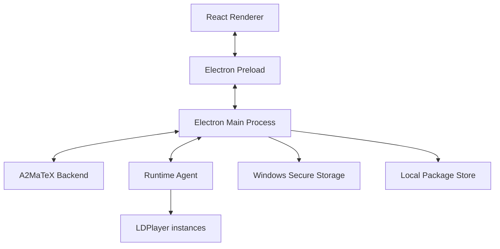

# 2. Kiến trúc tổng thể

Sử dụng Electron + React/TypeScript để đồng nhất với Studio.



## Renderer Process

Chỉ xử lý UI:

- Library sản phẩm.
- Device Manager.
- Run configuration.
- Execution monitor.
- Settings.

Renderer không được:

- đọc token trực tiếp;
- truy cập filesystem tùy ý;
- tạo subprocess;
- gọi ADB;
- giải mã package.

## Preload Layer

Cung cấp API giới hạn cho React:

```ts
window.a2matex.auth.login();
window.a2matex.products.list();
window.a2matex.devices.list();
window.a2matex.runs.start();
window.a2matex.runs.cancel();
window.a2matex.events.subscribe();
```

## Main Process

Thực hiện các tác vụ nhạy cảm:

- backend API;
- lưu access/refresh token;
- download package;
- filesystem;
- Runtime Agent lifecycle;
- local IPC;
- license renewal;
- system tray và auto-update.
