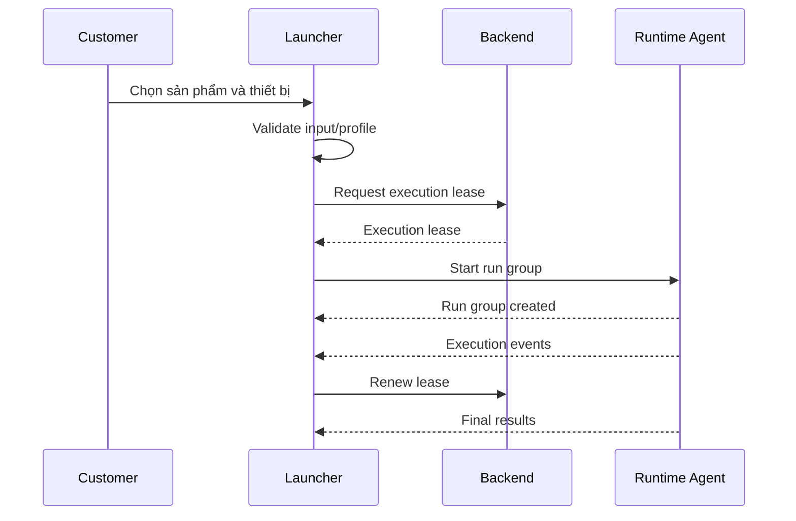

# 4. Luồng người dùng

## 4.1. Lần đầu mở Launcher

```text
Mở Launcher
→ đăng nhập
→ kiểm tra Runtime Agent
→ tìm LDPlayer installation
→ Runtime discovery devices
→ đồng bộ My Products
→ hiển thị Dashboard
```

Nếu không tìm thấy LDPlayer:

```text
Không tìm thấy LDPlayer
→ customer chọn thư mục cài đặt
→ Launcher gửi config cho Runtime
→ Runtime validate ldconsole.exe/adb.exe
→ refresh devices
```

## 4.2. Cài sản phẩm

```text
My Products
→ chọn sản phẩm
→ chọn Install
→ tải package
→ verify
→ kiểm tra Runtime compatibility
→ installed
```

## 4.3. Chạy workflow



Start request:

```json
{
  "release": {
    "productId": "product_01",
    "releaseId": "release_03",
    "packagePath": "packages/product_01/release_03/package.enc"
  },
  "lease": {},
  "executionPolicy": {
    "maxConcurrentDevices": 3,
    "failurePolicy": "CONTINUE_OTHER_DEVICES"
  },
  "devicePlans": [
    {
      "deviceId": "ldplayer:0",
      "inputs": {
        "accountName": "Account A"
      }
    }
  ]
}
```

Runtime trả:

```json
{
  "runGroupId": "run_01",
  "executions": [
    {
      "executionId": "exec_01",
      "deviceId": "ldplayer:0",
      "status": "QUEUED"
    }
  ]
}
```
