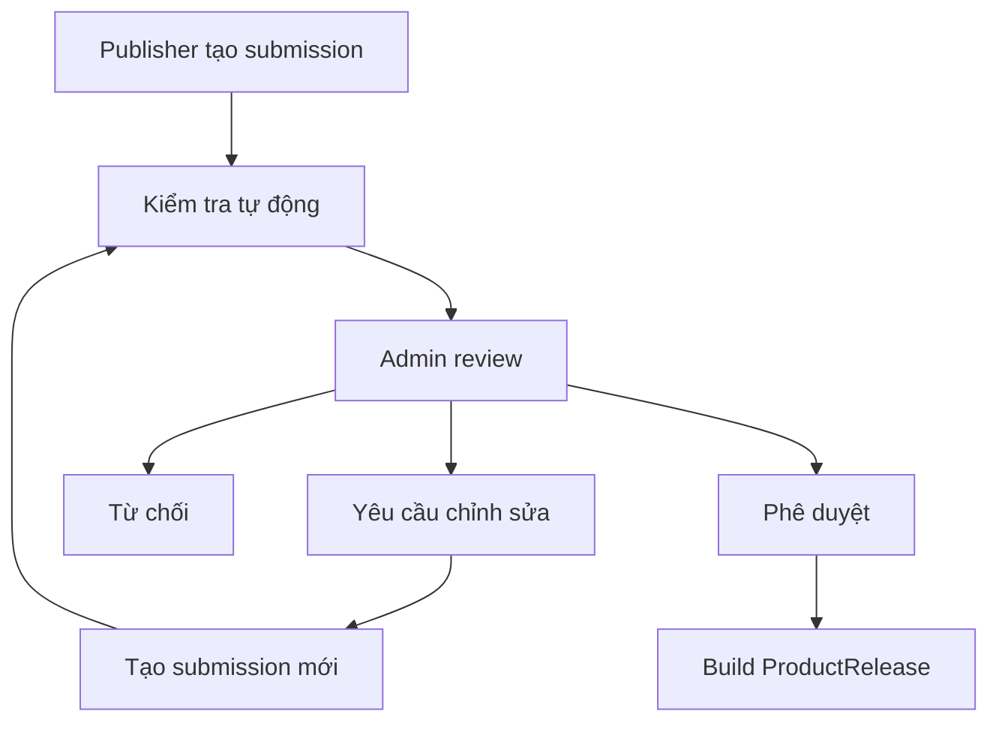

## 3. Mô hình sản phẩm

Cần phân biệt bốn khái niệm:

| Thành phần       | Ý nghĩa                                       |
| ---------------- | --------------------------------------------- |
| `Product`        | Sản phẩm logic do publisher sở hữu            |
| `ProductListing` | Metadata thương mại hiển thị trên Marketplace |
| `ProductRelease` | Phiên bản kỹ thuật đã được duyệt và publish   |
| `Submission`     | Snapshot publisher gửi để admin review        |

Ví dụ:

```text
Product: Auto mở rương game A
├── Listing: tên, mô tả, giá, media
├── Release 1.0.0
├── Release 1.1.0
└── Release 1.2.0 — current release
```

### 3.1. Product và ProductListing

Chứa thông tin có thể cập nhật mà không cần build lại workflow:

- Tên, slug, mô tả ngắn và mô tả chi tiết.
- Category và tags.
- Icon, screenshot và video demo.
- Publisher.
- Giá và chính sách sử dụng.
- Trạng thái hiển thị.
- Current release.

Thay đổi nhạy cảm như mục đích sản phẩm, category hoặc media chính có thể cần admin duyệt lại.

### 3.2. ProductRelease

Chứa thông tin kỹ thuật immutable:

- Version và changelog.
- Package object key và package hash.
- Workflow schema version.
- Input/output schema.
- Required capabilities.
- Minimum Launcher version.
- Minimum Runtime version.
- Payload hash và encryption metadata.
- Release notes và ngày phát hành.

ProductRelease đã publish không được ghi đè. Muốn sửa workflow phải tạo submission và release mới.

## 4. Submission từ Studio

Khi publisher bấm `Submit for Review`, Studio gửi dữ liệu lên Backend, không gửi trực tiếp vào Marketplace Web.

### 4.1. Product metadata

- Product ID nếu cập nhật sản phẩm hiện có.
- Product name, description và category.
- Giá và chính sách sử dụng.
- Icon, screenshot và video/demo instruction.
- Terms hoặc cảnh báo sử dụng.

### 4.2. Release snapshot

- Version và changelog.
- Project snapshot.
- Workflow graph hoặc Runtime IR.
- Input/output schema.
- Required capabilities.
- Minimum Launcher/Runtime version.
- Assets.
- Known limitations.

### 4.3. Review metadata

- Tài khoản hoặc môi trường test nếu cần.
- LDPlayer và Android version đã test.
- Android application/package được thao tác.
- Test instruction.
- Mục đích workflow.
- Danh sách hành động và dữ liệu mà workflow sử dụng.

### 4.4. Tính bất biến

Submission đã gửi là immutable. Khi admin yêu cầu chỉnh sửa:

```text
Submission 01: CHANGES_REQUESTED
→ Publisher sửa project trong Studio
→ Studio tạo Submission 02
→ Submission 02 tham chiếu Submission 01
→ Admin review snapshot mới
```

Không cập nhật snapshot của submission cũ.

## 5. Quy trình kiểm duyệt



### 5.1. Kiểm tra tự động

Backend hoặc review worker kiểm tra:

- Graph và schema hợp lệ.
- Có entry node và đường đi hợp lệ.
- Node type/version đều được hỗ trợ.
- Không có cycle hoặc loop không được kiểm soát.
- Input/output schema hợp lệ.
- Capability nằm trong allowlist.
- Code node tuân thủ giới hạn của hệ thống.
- Không có raw shell/ADB command do publisher tự chèn.
- Asset đầy đủ, đúng loại và không vượt kích thước.
- Package không chứa file ngoài format cho phép.
- Launcher/Runtime version tương thích.
- Test compile thành Runtime IR thành công.

Kết quả scan được lưu theo từng rule để admin biết lỗi nào chặn publish và lỗi nào chỉ là cảnh báo.

### 5.2. Admin review thủ công

Admin kiểm tra:

- Listing có phản ánh đúng hành vi workflow không.
- Workflow có hành vi nguy hiểm hoặc gây hiểu nhầm không.
- Có thu thập hoặc truyền dữ liệu nhạy cảm không.
- Capability yêu cầu có hợp lý không.
- Screenshot và video có đúng sản phẩm không.
- Workflow chạy được theo test instruction không.
- Sản phẩm có vi phạm điều khoản nền tảng không.

### 5.3. Trạng thái submission

| Trạng thái          | Ý nghĩa                                  |
| ------------------- | ---------------------------------------- |
| `PENDING`           | Đang chờ hoặc đang được review           |
| `CHANGES_REQUESTED` | Cần tạo submission mới sau khi chỉnh sửa |
| `APPROVED`          | Snapshot đã được duyệt                   |
| `REJECTED`          | Bị từ chối                               |

MVP chưa cần thêm nhiều trạng thái nội bộ. Scan status có thể lưu riêng với submission status.

## 6. Build và publish ProductRelease

Khi admin approve:

1. Backend xác nhận submission snapshot đã bị khóa.
2. Chạy lại validation trên đúng snapshot được duyệt.
3. Compile graph thành Runtime IR chuẩn.
4. Tạo content encryption key cho release.
5. Mã hóa workflow payload.
6. Đóng gói artifact dạng zip .a2m.
7. Tính package hash và lưu ngoài package.
8. Upload package lên Object Storage.
9. Tạo immutable `ProductRelease`.
10. Gán release làm current release khi publisher/admin chọn publish.

Cấu trúc package:

```text
product.a2m
├── manifest.json
├── workflow.enc
├── input-schema.json
└── assets/
```

Ví dụ `manifest.json`:

```json
{
  "productId": "product_01",
  "releaseId": "release_01",
  "version": "1.0.0",
  "workflowSchemaVersion": "1.0",
  "minimumLauncherVersion": "1.0.0",
  "minimumRuntimeVersion": "1.0.0",
  "entryWorkflowId": "main",
  "payloadHash": "sha256:...",
  "encryptionAlgorithm": "AES-256-GCM"
}
```

`packageHash` của toàn bộ `.a2m` được lưu trong `ProductRelease` và download metadata, không đặt vào chính package để tránh tự tham chiếu.

Hash dùng để:

- Phát hiện package bị thay đổi hoặc download thiếu.
- Xác định đúng release.
- Tránh chạy nhầm artifact.

Encryption chỉ làm tăng chi phí đọc workflow, không thể chống tuyệt đối reverse engineering trên máy customer.
