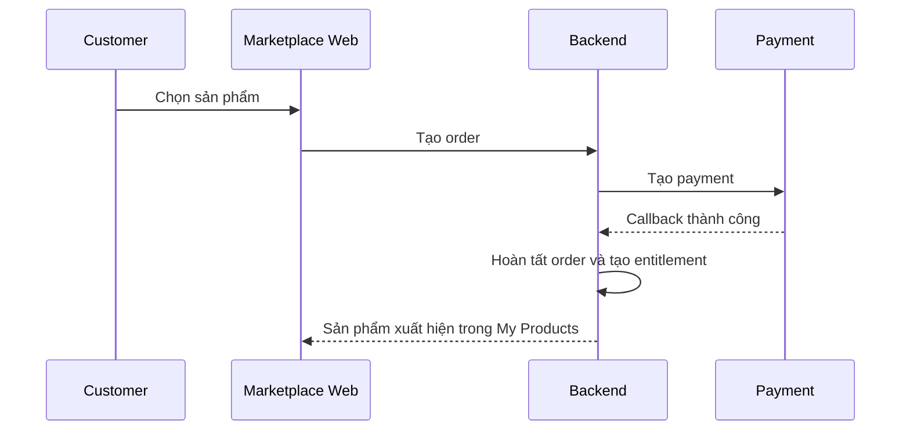

## 7. Luồng customer sở hữu sản phẩm



Customer nhận `Entitlement`, không nhận license key cố định.

Entitlement xác định:

- Customer được sử dụng product nào.
- Thời gian hiệu lực.
- Số Windows installation được đăng ký.
- Số Android device được chạy đồng thời.
- Quyền tải và cập nhật release.

## 8. Download package

Launcher yêu cầu download bằng access token:

```text
Launcher → Backend: yêu cầu download ProductRelease
Backend → kiểm tra entitlement
Backend → trả signed download URL ngắn hạn và packageHash
Launcher → Object Storage: download trực tiếp
Launcher → verify packageHash
```

File lớn không đi xuyên qua Marketplace Web hoặc application server. Runtime verify lại manifest, payload hash và release metadata trước khi chạy.

## 9. My Products

Màn hình My Products gồm:

- Product name và publisher.
- Current release và version đã cài.
- Entitlement status và expiration date.
- Max concurrent devices.
- Nút `Open in Launcher`.
- Nút `View details` và `Report`.

Link chỉ chứa định danh sản phẩm, không chứa access token, lease token hoặc workflow key. Launcher tự kiểm tra user session trước khi download hoặc chạy.

Website có thể mở Launcher bằng custom URL protocol:

```text
a2matex://products/product_01
```

Link chỉ chứa định danh sản phẩm, không chứa access token, lease token hoặc workflow key. Launcher tự kiểm tra user session trước khi download hoặc chạy.
