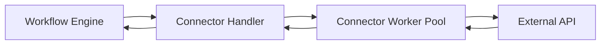

# 16. Nếu Android app chạy background job và không cập nhật màn hình

Đây là trường hợp quan trọng: **ADB command thành công không có nghĩa nghiệp vụ trong app đã thành công**.

Ví dụ Agent bấm nút “Submit”:

```text
ADB tap thành công
≠
Server của ứng dụng đã xử lý thành công
```

`Tap` node chỉ có thể kết luận:

```text
Command delivered successfully
```

Không thể tự kết luận:

```text
Business operation completed successfully
```

## Các mức xác nhận

| Mức | Ý nghĩa |
|---|---|
| DISPATCHED | Lệnh đã gửi tới thiết bị |
| OBSERVED | Phát hiện một trạng thái UI/log mong đợi |
| CONFIRMED | Kết quả được xác nhận qua API hoặc nguồn đáng tin cậy |

Workflow phải thêm bước xác nhận:

```text
Tap Submit
→ Wait For Element "Success"
→ If found
    ├── true: success
    └── false: retry/error
```

Nếu app không cập nhật màn hình:

```text
Tap Submit
→ Wait
→ HTTP/API Verification
→ If result exists
```

Hoặc:

```text
Tap Submit
→ Observe Notification
→ Verify message
```

Nếu không có UI, API, log, notification hoặc nguồn nào có thể quan sát, Runtime chỉ có thể trả `DISPATCHED`; nó không thể biết nghiệp vụ thật sự thành công.

Đây phải là một phần của node contract, tránh mọi node đều trả `success: true` một cách mơ hồ.

---

# 17. Background connector hoạt động thế nào?

Background node như:

- HTTP Request;
- Telegram;
- Email;
- Google Sheets;

không cần Android device.



Ví dụ Google Sheets node:

```go
func (h *AppendSheetHandler) Execute(
    ctx context.Context,
    input NodeExecutionInput,
) (NodeExecutionOutput, error) {
    credential, err := h.credentials.Resolve(
        input.Config.CredentialRef,
    )
    if err != nil {
        return NodeExecutionOutput{}, err
    }

    result, err := h.sheets.AppendRow(
        ctx,
        credential,
        input.Config.SpreadsheetID,
        input.ResolvedInput,
        input.IdempotencyKey(),
    )

    if err != nil {
        return NodeExecutionOutput{}, err
    }

    return NodeExecutionOutput{
        Data: map[string]any{
            "updatedRange": result.UpdatedRange,
        },
    }, nil
}
```

## Background không có nghĩa fire-and-forget

Trong MVP, workflow nên chờ connector result:

```text
Append Sheet
→ nhận success/error
→ đi node tiếp theo
```

Implementation có thể chạy trong worker pool, nhưng về execution semantics node vẫn là request/response.

Fire-and-forget gây khó:

- không biết job có thành công không;
- workflow kết thúc trước job;
- retry có thể gửi trùng;
- Launcher không biết trạng thái cuối.

Nếu sau này cần fire-and-forget, tạo node riêng:

```text
Submit Background Job
→ output jobId
```

và một node:

```text
Wait For Job
```

# 18. Node connector chạy một lần cho từng thiết bị hay một lần cho cả nhóm?

Mặc định mọi node trong graph chạy theo `DeviceExecution`.

Nếu chọn 10 thiết bị:

```text
Google Sheets Append Row
→ chạy 10 lần
→ mỗi thiết bị ghi một dòng
```

Mỗi call có idempotency key:

```text
<executionId>:<nodeId>:<sequence>
```

Ví dụ:

```text
exec_device_A:append_sheet:14
```

Nếu retry cùng node execution thì dùng lại key, giảm nguy cơ ghi trùng.

## Node tổng hợp run group

Không nên trộn trực tiếp vào device graph ở MVP. Có thể bổ sung `Run Group Finalizer` sau:

```text
Khi tất cả device executions kết thúc
→ tổng hợp kết quả
→ gửi một email tổng kết
```

Nếu MVP chưa có group-level workflow, Launcher có thể thực hiện bước tổng hợp qua một handler riêng sau khi Run Group Coordinator hoàn tất.


# 19. Nếu Launcher đóng nhưng background job vẫn chạy thì sao?

Runtime Agent nên là process độc lập với Launcher UI.

## MVP đơn giản

```text
Launcher mở → Agent chạy
Launcher đóng → hỏi:
  "Stop running workflows?"
  "Keep Agent running in background?"
```

Nếu chọn tiếp tục:

- Launcher UI đóng;
- Agent vẫn chạy ở system tray;
- workflow tiếp tục;
- khi mở lại Launcher, UI gọi `/v1/runs`;
- Agent đọc trạng thái từ SQLite và hiển thị lại.

Không nên triển khai Windows Service ngay vì LDPlayer và ADB thường chạy trong user session. Một **per-user background process/tray application** dễ quản lý hơn.

## Studio development mode

Khi Studio đóng:

- nếu đang test, mặc định cancel;
- hoặc cảnh báo trước khi đóng;
- không cần giữ development run lâu dài.
