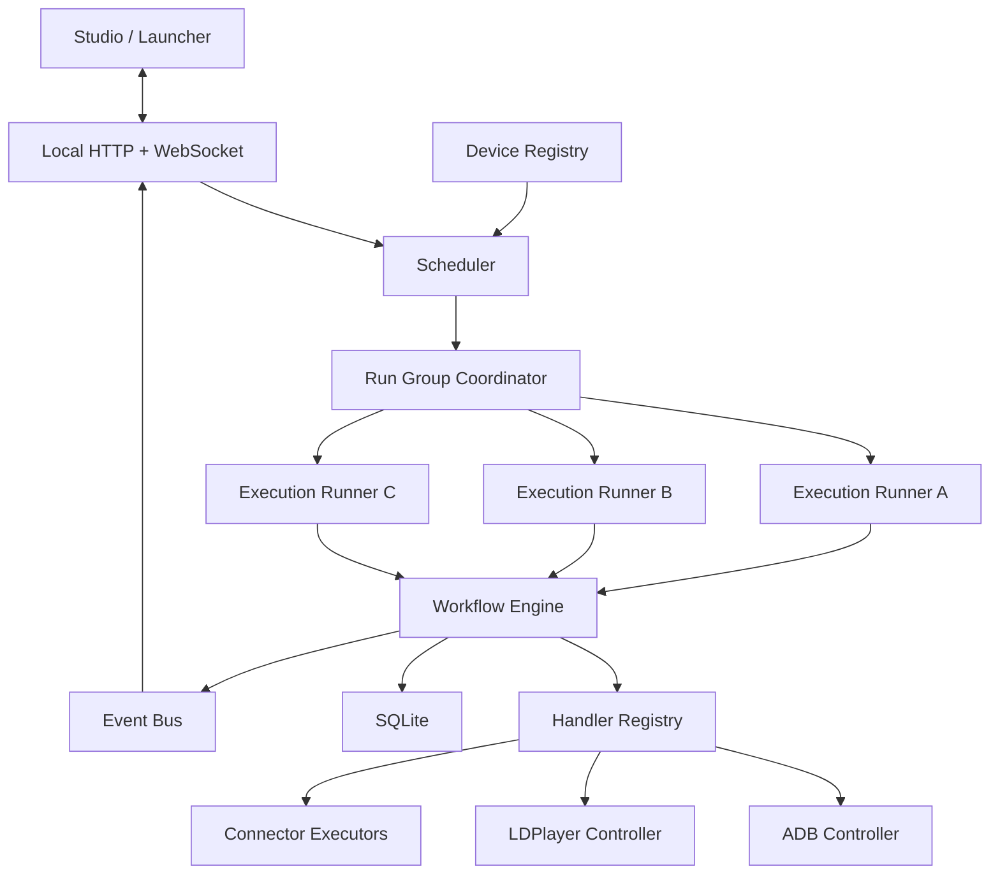

# 30. Kiến trúc MVP

Runtime Agent nên được xây như một **local workflow execution daemon bằng Go**, không phải một tập script ADB.

Mô hình triển khai cốt lõi:

1. `Device Registry` phát hiện tất cả LDPlayer/ADB device.
2. Launcher cho người dùng chọn thiết bị.
3. `Scheduler` tạo một device execution cho mỗi thiết bị được chọn.
4. Mỗi device execution chạy trong một goroutine độc lập.
5. Mỗi thiết bị có exclusive lease để không bị hai workflow điều khiển cùng lúc.
6. Workflow Engine chạy node tuần tự trên từng thiết bị.
7. Android handler chuyển node thành typed `DeviceCommand`.
8. Device Adapter chuyển command thành ADB/LDPlayer CLI.
9. Background handler gọi connector mà không phụ thuộc màn hình Android.
10. SQLite lưu checkpoint; Event Bus cập nhật Studio/Launcher.
11. Command thành công chỉ xác nhận thao tác được gửi; muốn xác nhận nghiệp vụ phải có observation node hoặc external verification.

Thứ tự triển khai hợp lý nhất là: **device discovery → command adapter → single-device engine → multi-device scheduler → persistence/event → connector → license/security**. Nếu spike đầu tiên chưa điều khiển độc lập được hai LDPlayer instance và lấy screenshot riêng từ từng instance, chưa nên đi tiếp sang Marketplace hoặc mã hóa workflow.