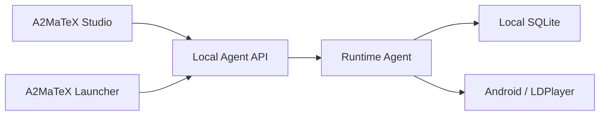

# 2. Runtime Agent chạy như thế nào?

Runtime Agent nên là một executable Go độc lập:

```text
a2matex-runtime-agent.exe
```

Studio và Launcher đều là client của executable này.



## Hai chế độ chạy

### Development mode

Dùng trong Studio:

```text
a2matex-runtime-agent.exe --mode=development
```

Cho phép:

- chạy draft Runtime IR;
- chạy một node;
- run from node;
- mock input;
- debug chi tiết;
- không cần production license.

### Production mode

Dùng trong Launcher:

```text
a2matex-runtime-agent.exe --mode=production
```

Chỉ cho phép:

- release đã ký;
- node/version đã được duyệt;
- capability đã được cấp;
- execution lease hợp lệ;
- số thiết bị không vượt license.

Cùng một engine nhưng khác policy.


# 3. Giao tiếp giữa Studio/Launcher và Runtime Agent

Đối với MVP, nên dùng:

- HTTP JSON trên `127.0.0.1`;
- WebSocket hoặc Server-Sent Events cho progress event.

Chưa cần gRPC vì:

- Studio và Launcher chủ yếu cần request/response JSON;
- debug local dễ hơn;
- WebSocket đủ cho event realtime;
- không phải quản lý protobuf ngay.

Ví dụ local API:

```text
GET    /v1/health
GET    /v1/runtime-info
GET    /v1/devices
POST   /v1/devices/refresh

POST   /v1/runs
GET    /v1/runs/{runGroupId}
POST   /v1/runs/{runGroupId}/pause
POST   /v1/runs/{runGroupId}/resume
POST   /v1/runs/{runGroupId}/cancel

POST   /v1/test/node
POST   /v1/test/workflow

GET    /v1/events
```

Agent chỉ bind vào loopback:

```text
127.0.0.1:<random-port>
```

Khi khởi động, Agent sinh local session token. Studio/Launcher phải gửi token đó để tránh ứng dụng khác trên máy tùy ý gọi Agent.
