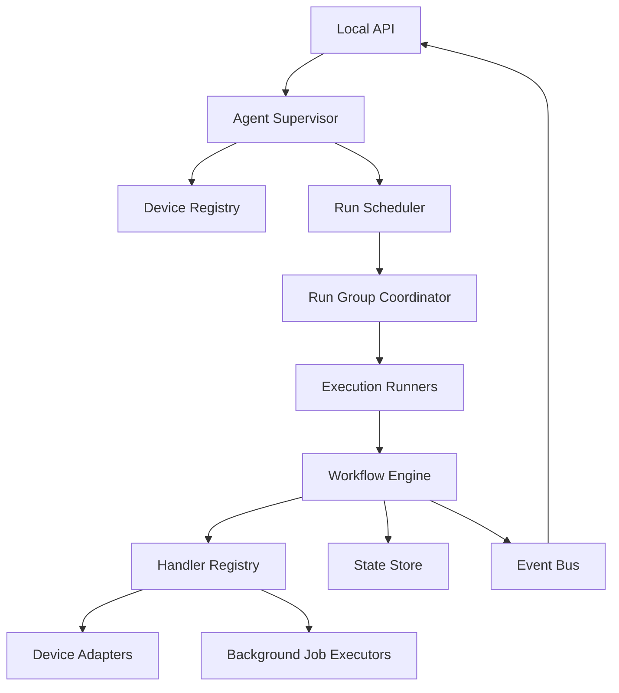

# 4. Kiến trúc tổng thể bên trong Runtime Agent



## Các thành phần chính

| Thành phần | Trách nhiệm |
|---|---|
| Agent Supervisor | Khởi động, shutdown và quản lý lifecycle |
| Device Registry | Phát hiện và giữ trạng thái thiết bị |
| Run Scheduler | Kiểm tra tài nguyên và xếp hàng execution |
| Run Group Coordinator | Quản lý một lần chạy trên nhiều thiết bị |
| Execution Runner | Chạy workflow cho một thiết bị |
| Workflow Engine | Quyết định node kế tiếp |
| Handler Registry | Ánh xạ node type → handler |
| Device Adapter | Chuyển Android action thành command |
| Background Executor | Thực hiện HTTP, Sheets, Telegram… |
| State Store | Lưu execution, node result và checkpoint |
| Event Bus | Phát progress/log cho UI |
| Artifact Store | Lưu screenshot, UI dump, debug output |
| Policy Engine | Capability, quota, Runtime mode, lease |


# 5. Cấu trúc repo đề xuất

Theo clean architecture nhưng không tách quá vụn:

```text
a2matex-runtime-agent/
├── cmd/
│   └── agent/
│       └── main.go
│
├── internal/
│   ├── agent/
│   │   ├── supervisor.go
│   │   └── config.go
│   │
│   ├── workflow/
│   │   ├── model.go
│   │   ├── engine.go
│   │   ├── resolver.go
│   │   ├── transition.go
│   │   └── validator.go
│   │
│   ├── execution/
│   │   ├── run_group.go
│   │   ├── device_execution.go
│   │   ├── scheduler.go
│   │   ├── runner.go
│   │   └── state_machine.go
│   │
│   ├── nodes/
│   │   ├── registry.go
│   │   ├── handler.go
│   │   ├── flow/
│   │   ├── android/
│   │   ├── data/
│   │   └── connector/
│   │
│   ├── device/
│   │   ├── model.go
│   │   ├── registry.go
│   │   ├── discovery.go
│   │   ├── lease_manager.go
│   │   └── controller.go
│   │
│   ├── adapters/
│   │   ├── adb/
│   │   ├── ldplayer/
│   │   ├── http/
│   │   ├── telegram/
│   │   └── googlesheets/
│   │
│   ├── capability/
│   ├── package/
│   ├── persistence/
│   │   └── sqlite/
│   ├── artifact/
│   ├── events/
│   └── transport/
│       ├── http/
│       └── websocket/
│
├── migrations/
├── testdata/
└── tests/
    ├── integration/
    └── fixtures/
```