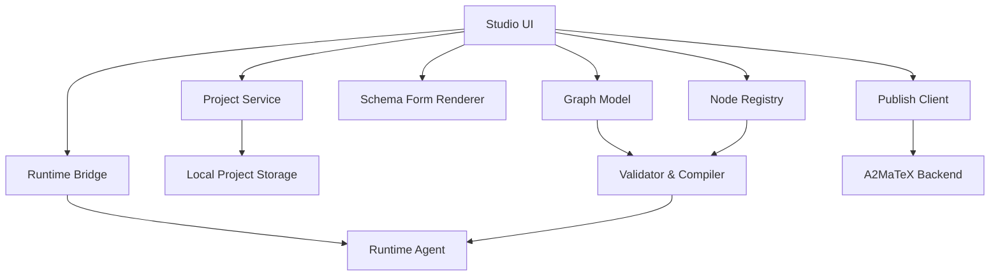

# 4. Kiến trúc nội bộ của Studio



## 4.1. Desktop Shell

Desktop shell quản lý:

- cửa sổ ứng dụng;
- project local;
- file dialog;
- cập nhật Studio;
- khởi động Runtime Agent sidecar;
- local IPC;
- crash recovery.

Về công nghệ, có thể chọn:

- React + Electron;
- React + Tauri;
- hoặc web UI đóng gói thành desktop application.

Với đội hiện tại, React/TypeScript cho editor và Go cho Runtime Agent là cấu trúc hợp lý. Runtime Agent nên chạy thành một process riêng; renderer của Studio không trực tiếp gọi ADB.

## 4.2. Graph Editor

Graph Editor chịu trách nhiệm thuần giao diện:

- node placement;
- edge drawing;
- selection;
- drag/drop;
- undo/redo;
- viewport;
- visual state.

Nó không quyết định execution semantics. Ví dụ người dùng nối hai node thành vòng tròn, editor có thể hiển thị edge, nhưng Validator phải từ chối vì vòng lặp tùy ý không được hỗ trợ.

## 4.3. Graph Model

Graph Model là source of truth trong Studio:

```ts
interface EditorGraph {
  schemaVersion: string;
  nodes: WorkflowNode[];
  edges: WorkflowEdge[];
  variables: VariableDefinition[];
  inputs: InputDefinition[];
  assets: AssetReference[];
  metadata: EditorMetadata;
}
```

Editor metadata chứa tọa độ canvas, màu nhóm và trạng thái UI. Những thông tin này không cần đưa vào Runtime IR.

## 4.4. Node Registry

Node Registry chứa toàn bộ node mà Studio biết:

```text
Node Registry
├── Android nodes
├── Observation nodes
├── Flow-control nodes
├── Data nodes
├── Connector nodes
└── Debug nodes
```

Registry không chỉ chứa tên node. Nó chứa `NodeDefinition`:

```ts
interface NodeDefinition {
  type: string;
  version: number;

  displayName: string;
  category: string;
  description: string;
  icon: string;

  configSchema: JsonSchema;
  inputSchema: JsonSchema;
  outputSchema: JsonSchema;

  outputs: OutputPortDefinition[];
  requiredCapabilities: string[];

  runtimeHandler: string;
  editorHints: EditorHints;

  defaultTimeoutMs: number;
  supportedErrorPolicies: string[];
}
```

Một definition có thể được dùng để tự động sinh:

- node trong palette;
- form cấu hình;
- validation rule;
- input/output documentation;
- permission summary;
- Runtime handler mapping;
- tài liệu cho Marketplace review.

Đây là cơ chế quan trọng nhất nếu mục tiêu là mở rộng nhanh số lượng node.

## 4.5. Schema Form Renderer

Form Renderer đọc `configSchema` và sinh control tương ứng:

| Schema | UI |
|---|---|
| `string` | Text input |
| `number` | Number input |
| `boolean` | Switch |
| `enum` | Dropdown |
| `secretRef` | Credential selector |
| `deviceSelector` | Device field |
| `coordinate` | Screen coordinate picker |
| `assetRef` | Asset picker |
| `duration` | Duration input |
| `expression` | Expression editor |

Một node mới sử dụng các field tiêu chuẩn sẽ không cần lập trình thêm UI.

Chỉ các node đặc biệt như coordinate picker hoặc image-region selector mới cần custom editor component.

## 4.6. Validator và Compiler

Validator hoạt động theo nhiều tầng:

### Schema validation

- node có đúng cấu hình không;
- field bắt buộc đã có chưa;
- kiểu dữ liệu có hợp lệ không.

### Graph validation

- có đúng một Start node;
- có node không thể truy cập;
- có output chưa nối;
- có vòng lặp bất hợp lệ;
- branch thiếu default;
- End node có hợp lệ;
- graph có đường chạy không kết thúc.

### Type validation

- output của node trước có phù hợp input node sau;
- expression tham chiếu field có tồn tại;
- biến có đúng kiểu.

### Capability validation

- workflow có dùng ADB;
- có dùng screenshot;
- có dùng Google Sheets;
- có gọi HTTP;
- có dùng credential.

### Runtime compatibility

- handler version có tồn tại;
- Runtime tối thiểu có hỗ trợ node;
- node cũ có cần migrate không.

Compiler sau đó chuyển Editor Graph thành Runtime IR.
